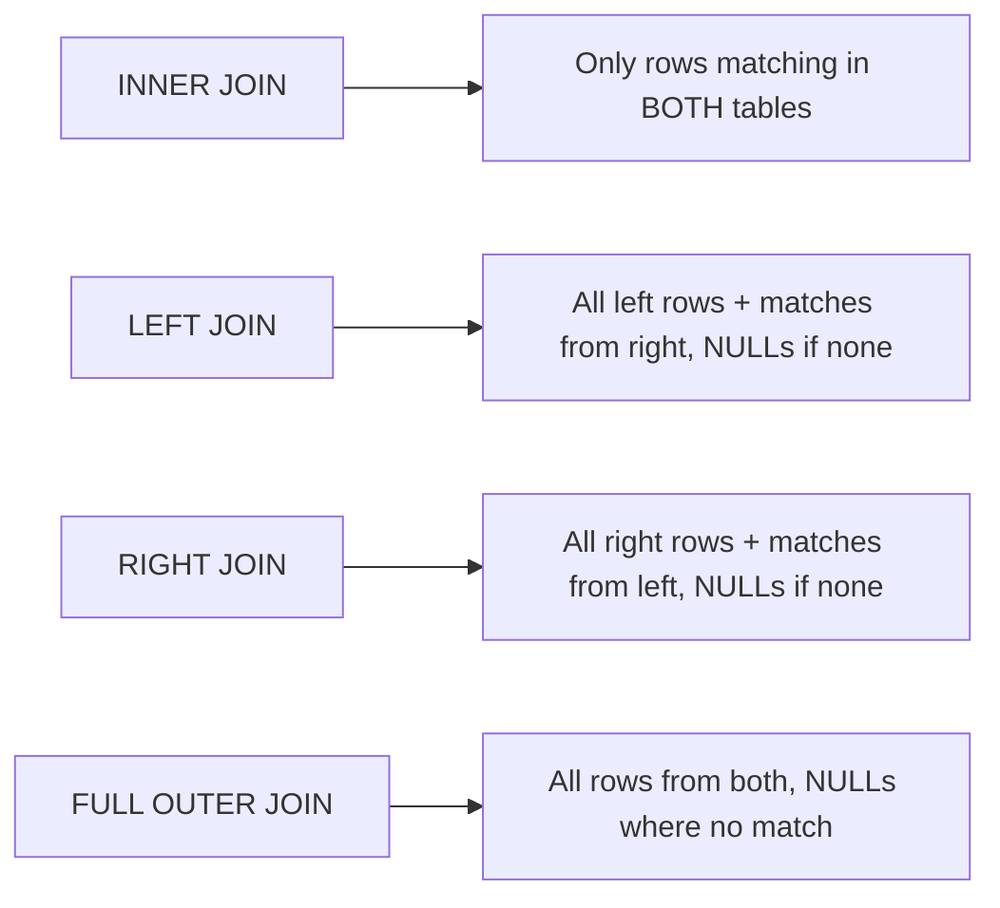

import RelationalModelAndSqlQuestions from './_partials/02-relational-model-and-sql-questions.mdx';

# Relational Model, Keys & SQL

The relational model is a set of tables (relations), each a fixed set of typed columns
(attributes) holding rows (tuples). Everything an RDBMS does &mdash; joins, constraints,
normalization, query optimization &mdash; is built on top of this simple structure and the keys
that tie tables together.

## Keys

- **Super key** &mdash; any column (or set of columns) that uniquely identifies a row. A table can
  have many super keys, including redundant ones (e.g. `{id}` and `{id, email}` are both super keys
  if `id` alone is unique).
- **Candidate key** &mdash; a *minimal* super key: no column can be removed from it and still have
  it uniquely identify rows. A table can have multiple candidate keys (e.g. `id` and `email` might
  both independently be unique).
- **Primary key** &mdash; the candidate key chosen as *the* official identifier for the table.
  Exactly one per table; enforces both uniqueness and `NOT NULL`.
- **Alternate key** &mdash; any candidate key that wasn't chosen as the primary key.
- **Composite key** &mdash; a primary (or candidate) key made of more than one column, used when no
  single column is unique on its own (e.g. `(order_id, product_id)` in an order-items table).
- **Foreign key** &mdash; a column (or columns) in one table that references the primary key of
  another table, enforcing referential integrity: you cannot insert a row pointing at a parent that
  doesn't exist, and (depending on the `ON DELETE`/`ON UPDATE` rule) deleting a referenced parent
  row can `CASCADE`, `SET NULL`, or be `RESTRICT`ed.

```sql
CREATE TABLE orders (
    id          BIGINT PRIMARY KEY,
    customer_id BIGINT NOT NULL REFERENCES customers(id) ON DELETE RESTRICT,
    created_at  TIMESTAMP NOT NULL DEFAULT now()
);

CREATE TABLE order_items (
    order_id    BIGINT REFERENCES orders(id) ON DELETE CASCADE,
    product_id  BIGINT REFERENCES products(id),
    quantity    INT NOT NULL CHECK (quantity > 0),
    PRIMARY KEY (order_id, product_id) -- composite key
);
```

## Constraints

Constraints are rules the DBMS enforces on every write, regardless of which application issued it:

| Constraint | What it enforces |
|---|---|
| `PRIMARY KEY` | Uniqueness + not null, one per table |
| `FOREIGN KEY` | Referenced row must exist |
| `UNIQUE` | No duplicate values in the column(s), nulls typically excluded |
| `NOT NULL` | Column must always have a value |
| `CHECK` | An arbitrary boolean expression must hold (e.g. `quantity > 0`) |
| `DEFAULT` | Value used when none is supplied on insert |

## Join types

Joins combine rows from two or more tables based on a related column.



- **INNER JOIN** &mdash; returns only rows that have a match in both tables.
- **LEFT (OUTER) JOIN** &mdash; all rows from the left table, matched rows from the right where
  they exist, `NULL` for right-side columns otherwise.
- **RIGHT (OUTER) JOIN** &mdash; the mirror of `LEFT JOIN`.
- **FULL OUTER JOIN** &mdash; all rows from both tables, `NULL`-filled on whichever side has no
  match.
- **SELF JOIN** &mdash; a table joined to itself, used for hierarchical/comparative data (e.g. an
  `employees` table where each row has a `manager_id` pointing at another row in the same table).
- **CROSS JOIN** &mdash; the Cartesian product of both tables (every row paired with every row of
  the other table); rarely intentional in application code, but it's what you get if you write a
  multi-table `FROM` clause without a join condition.

```sql
-- Self join: each employee alongside their manager's name
SELECT e.name AS employee, m.name AS manager
FROM employees e
LEFT JOIN employees m ON e.manager_id = m.id;
```

## SQL command categories

SQL commands are grouped by what they operate on:

- **DDL (Data Definition Language)** &mdash; defines/alters structure: `CREATE`, `ALTER`, `DROP`,
  `TRUNCATE`. These are typically auto-committed and can't be rolled back in most databases.
- **DML (Data Manipulation Language)** &mdash; manipulates data: `SELECT`, `INSERT`, `UPDATE`,
  `DELETE`. These participate in transactions (see [Transactions & ACID](./05-transactions-and-acid.md)).
- **DCL (Data Control Language)** &mdash; manages permissions: `GRANT`, `REVOKE`.
- **TCL (Transaction Control Language)** &mdash; manages transaction boundaries: `COMMIT`,
  `ROLLBACK`, `SAVEPOINT`.

:::info Interview Questions
<RelationalModelAndSqlQuestions/>
:::
