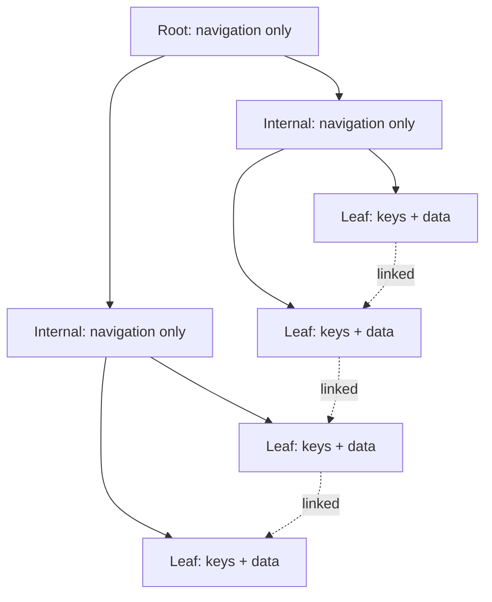

import IndexingQuestions from './_partials/04-indexing-questions.mdx';

# Indexing

An index is the single highest-leverage tool for query performance, and it's the topic where
interviewers most reliably probe whether you understand *why* it works, not just that adding one
makes a slow query fast.

## What an index is

An **index** is a separate, ordered data structure that maps column values to the physical
location of the rows that hold them, so the database can find matching rows without scanning every
row in the table. Without an index, `WHERE email = 'x@example.com'` is a full table scan &mdash;
`O(n)`. With a B-tree index on `email`, it's a tree traversal &mdash; `O(log n)`.

That speed isn't free: every index is a second (or third...) structure the database must keep in
sync on every `INSERT`, `UPDATE`, or `DELETE`, and it takes disk space. Indexes are a read/write
tradeoff, not a free performance upgrade.

## B-tree vs. B+tree

Almost every general-purpose relational index (PostgreSQL's default `btree`, MySQL/InnoDB's
clustered index) is actually a **B+tree**, and the naming is a common source of confusion:

- A classic **B-tree** stores keys *and* data at every node, internal and leaf alike.
- A **B+tree** stores keys only in internal nodes (used purely for navigation) and stores all
  actual data in the leaf nodes, which are additionally linked together in a sequence.

That leaf-linked-list structure is why B+trees are what databases actually use: range queries
(`WHERE age BETWEEN 20 AND 30`, `ORDER BY`) can jump to the starting leaf and then walk the linked
leaves directly, instead of re-traversing the tree for every value in the range.



## Hash index vs. B-tree index

A **hash index** maps a key to a bucket via a hash function, giving `O(1)` average lookup for exact
equality (`WHERE id = 5`) but nothing else: hash indexes can't satisfy range queries or sorting,
because hashing deliberately destroys ordering. A **B+tree index** is slightly slower for pure
equality lookups but supports equality, range, prefix, and sorted-order queries. That's why B+tree
is the default for general-purpose indexes and hash indexes are reserved for specific,
equality-only, high-throughput lookup use cases (some KV-style engines, or specialized index types
in Postgres).

## Clustered vs. non-clustered index

A **clustered index** determines the physical storage order of the table's rows &mdash; the table
*is* the index's leaf level. A table can have at most one clustered index, because rows can only be
physically sorted one way. A **non-clustered (secondary) index** is a separate structure that maps
key values to a pointer/row-locator back into the table's actual storage; a table can have many.

Looking up via a non-clustered index typically costs an extra step (a "bookmark lookup" back to the
table) unless the index is *covering* (below). In InnoDB, the primary key **is** the clustered
index, and every secondary index stores the primary key value as its row pointer &mdash; which is
part of why a wide/inefficient primary key bloats every secondary index too.

## Composite indexes and column order

A **composite (multi-column) index** covers `(col_a, col_b, col_c)` and is only useful, as a
B+tree, for queries that filter on a *left-prefix* of those columns &mdash; `col_a`, or
`col_a, col_b`, or all three, but not `col_b` alone. This is the leading cause of "I have an index
but the query still scans the table" bugs: the query's filter order (or lack of a leading column)
doesn't match the index's column order.

```sql
CREATE INDEX idx_orders_customer_status ON orders (customer_id, status);

-- Uses the index (matches the leading column, or both)
SELECT * FROM orders WHERE customer_id = 42;
SELECT * FROM orders WHERE customer_id = 42 AND status = 'shipped';

-- Cannot use this index efficiently (status isn't a leading column)
SELECT * FROM orders WHERE status = 'shipped';
```

## Covering index

An index is **covering** for a query when every column the query needs (`SELECT`, `WHERE`,
`ORDER BY`) is present in the index itself, so the database can answer the query entirely from the
index without a bookmark lookup back to the table. This is one of the most effective real-world
tuning techniques &mdash; extending an index to include a couple of extra columns can turn a
two-step lookup into a single index-only scan.

## When an index hurts

Every write to an indexed column touches every index on that table, not just the table row, so
tables with many indexes on write-heavy paths pay a real cost. Indexes also compete for buffer pool
memory (see [Storage, Buffer Management & Recovery](./08-storage-and-recovery.md)) and disk space.
The rule of thumb interviewers look for: index columns that are actually filtered/sorted/joined on
frequently, not every column "just in case," and periodically check for unused indexes.

:::info Interview Questions
<IndexingQuestions/>
:::
