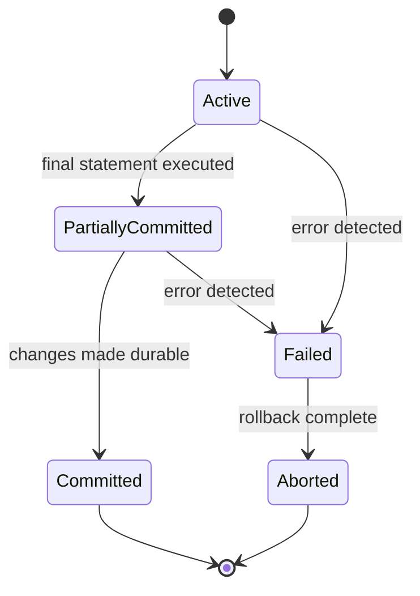

import TransactionsAndAcidQuestions from './_partials/05-transactions-and-acid-questions.mdx';

# Transactions & ACID

A **transaction** is a sequence of one or more operations treated as a single, indivisible unit of
work &mdash; either everything in it happens, or none of it does. ACID is the set of guarantees a
relational database makes about every transaction.

## The four ACID properties

- **Atomicity** &mdash; a transaction is all-or-nothing. If a transfer debits one account and
  credits another, and the process crashes after the debit but before the credit, atomicity means
  the debit is rolled back too &mdash; the database never observes a half-applied transaction.
- **Consistency** &mdash; a transaction takes the database from one valid state to another, never
  violating constraints (foreign keys, checks, uniqueness) along the way. This is largely a
  consequence of the other three properties plus the schema's own constraints, rather than
  something the database enforces independently.
- **Isolation** &mdash; concurrent transactions don't see each other's uncommitted intermediate
  state. How strictly this is enforced is configurable &mdash; see
  [Concurrency Control & Isolation Levels](./06-concurrency-control-and-isolation.md) for the
  levels and the anomalies each one permits.
- **Durability** &mdash; once a transaction commits, the change survives a crash, even if the
  server loses power a millisecond later. In practice this is implemented via a **write-ahead log
  (WAL)** &mdash; see [Storage, Buffer Management & Recovery](./08-storage-and-recovery.md) for how.

## Transaction states



- **Active** &mdash; statements are executing.
- **Partially committed** &mdash; the final statement has run, but changes aren't yet durably
  written.
- **Committed** &mdash; the transaction succeeded and its effects are permanent.
- **Failed** &mdash; an error occurred and normal execution can't continue.
- **Aborted** &mdash; the transaction was rolled back and the database is restored to its
  pre-transaction state.

## Explicit vs. implicit transactions

Every single SQL statement runs inside a transaction, even if you never type `BEGIN` &mdash; most
databases default to **autocommit**, wrapping each statement in its own implicit transaction that
commits immediately if it succeeds. `BEGIN`/`START TRANSACTION` turns off autocommit and lets you
group multiple statements into one atomic unit, ended explicitly with `COMMIT` or `ROLLBACK`.

```sql
BEGIN;

UPDATE accounts SET balance = balance - 100 WHERE id = 1;
UPDATE accounts SET balance = balance + 100 WHERE id = 2;

COMMIT; -- both updates become durable together, or neither does
```

## COMMIT vs. ROLLBACK

`COMMIT` ends the transaction and makes all its changes permanent and visible to other
transactions. `ROLLBACK` ends the transaction and discards every change made since it began,
restoring the pre-transaction state &mdash; used both for explicit "undo this" logic and
automatically by the database when a statement inside the transaction errors.

## Savepoints

A **savepoint** is a named marker inside a transaction that you can roll back to *without*
discarding the entire transaction. Useful when a transaction does several logical steps and only
one of them might fail in a recoverable way (e.g. bulk-processing several independent updates where
one bad row shouldn't abort the whole batch).

```sql
BEGIN;

INSERT INTO orders (id, customer_id) VALUES (1, 42);
SAVEPOINT before_risky_step;

UPDATE inventory SET stock = stock - 1 WHERE product_id = 999; -- fails: constraint violation
ROLLBACK TO SAVEPOINT before_risky_step; -- undoes only the failed step

COMMIT; -- the order insert is still committed
```

:::info Interview Questions
<TransactionsAndAcidQuestions/>
:::
