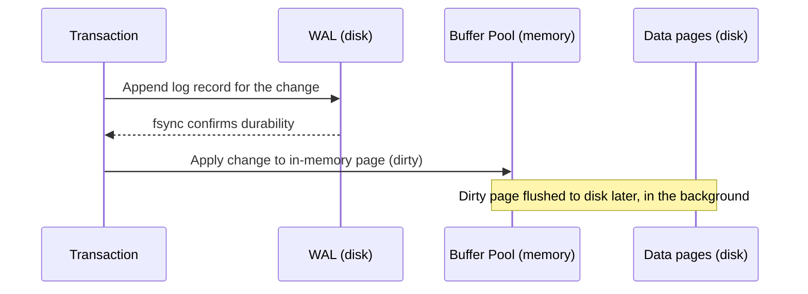

import StorageAndRecoveryQuestions from './_partials/08-storage-and-recovery-questions.mdx';

# Storage, Buffer Management & Recovery

Everything above this page &mdash; transactions, isolation, indexes &mdash; ultimately has to be
implemented on top of a disk that's slow relative to memory and that can lose power mid-write. This
page covers the physical layer that makes ACID's durability guarantee actually possible.

## Pages and blocks

The database doesn't read or write individual rows to disk &mdash; it reads and writes fixed-size
**pages** (also called blocks), typically 4KB, 8KB, or 16KB depending on the engine (Postgres
defaults to 8KB). A page holds many rows, plus a bit of header/metadata. This matters because it
means a single-row read still costs at least one full page read, and it's why row size and how
tightly rows pack into a page directly affects I/O efficiency &mdash; a table with wide rows or a
lot of dead/bloated space fits fewer useful rows per page.

## The buffer pool

Reading from disk on every query would be far too slow, so the database keeps a **buffer pool**
(a.k.a. buffer cache) &mdash; an in-memory cache of recently/frequently used pages. Reads check the
buffer pool first; only a miss goes to disk. Writes typically modify the in-memory page (marking it
"dirty") and are flushed to disk later, not immediately &mdash; which is exactly why durability
can't rely on the buffer pool alone and needs the write-ahead log below.

A high **buffer pool hit ratio** (cache hits vs. total reads) is one of the first things to check
when diagnosing a slow database &mdash; a low ratio usually means either the working set doesn't
fit in memory or the buffer pool is undersized for the workload.

## Write-ahead logging (WAL)

**WAL** is the mechanism that makes durability possible without requiring every committed
transaction to synchronously flush every changed data page to disk (which would be far too slow).
The rule: before any change is applied to the actual data pages, a record of that change is first
appended to a sequential, append-only **log file** and flushed to disk. On commit, the database only
needs to guarantee the *log* record is durably written &mdash; the actual data page can be flushed
to disk later, lazily, in the background.

This is a major performance win &mdash; sequential appends to a log file are cheap compared to
random writes across scattered data pages &mdash; and it's also what makes crash recovery possible
at all, since the log is the record of everything that happened.

## Checkpointing

If the WAL just grew forever and recovery had to replay it from the very beginning of time, crash
recovery would get slower the longer the database had been running. A **checkpoint** periodically
flushes all currently-dirty buffer pool pages to disk and records a marker in the log saying "as of
this point, all data pages are consistent with the log up to here." Recovery after a crash then only
needs to replay the log starting from the most recent checkpoint, not from the beginning.

## Crash recovery: redo and undo

After an unclean shutdown, recovery (e.g. Postgres's/most systems' ARIES-style algorithm) does two
passes over the WAL starting from the last checkpoint:

- **Redo** &mdash; re-apply every logged change, including ones from transactions that never
  committed, bringing data pages back to exactly the state they were in at the moment of the crash.
- **Undo** &mdash; then roll back the changes belonging to transactions that were still active
  (uncommitted) at crash time, since those should never have taken effect.

This redo-then-undo order (rather than skipping uncommitted changes during redo) is what makes the
algorithm correct even when a dirty page from an uncommitted transaction was already flushed to
disk before the crash.

:::info Interview Questions
<StorageAndRecoveryQuestions/>
:::
