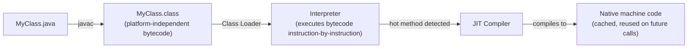
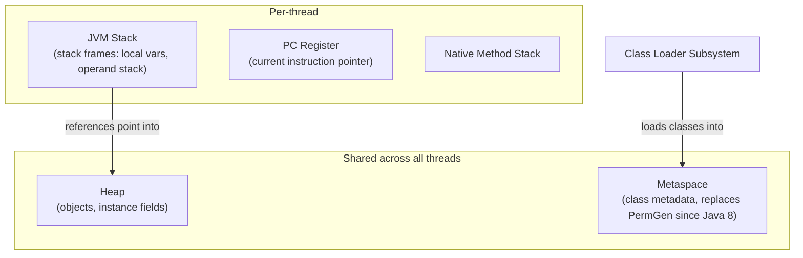

import JvmAndMemoryModelQuestions from './_partials/02-jvm-and-memory-model-questions.mdx';

# JVM & Memory Model

"Java doesn't have memory leaks because it has garbage collection" is one of the most common
misconceptions candidates walk in with. This page builds the actual mental model of where Java
objects live, how they get reclaimed, and why applications can still leak memory despite all of
it being automatic.

## JDK, JRE, and JVM

Before anything about garbage collection, most interviews open with the layering that trips up
candidates who've only ever run `java` and `javac` without thinking about what's underneath them:

- **JVM (Java Virtual Machine)**: the runtime engine that executes compiled bytecode. It's
  platform-specific — a different JVM build per OS/architecture — but the bytecode it runs is not.
  This is what "write once, run anywhere" actually means in practice: `javac` doesn't target a
  specific OS, it targets the JVM's instruction set, and each platform's JVM implementation handles
  translating that to native execution.
- **JRE (Java Runtime Environment)**: the JVM plus the standard class libraries (`java.lang`,
  `java.util`, ...) and supporting files needed to *run* a compiled Java application. No compiler
  included — it's a runtime-only distribution.
- **JDK (Java Development Kit)**: the JRE plus development tooling — `javac` (the compiler), `jar`,
  `javadoc`, a debugger. It's the superset needed to *write and compile* Java code, not just run it.

So the containment is `JVM ⊂ JRE ⊂ JDK`. (Since JDK 11, Oracle stopped shipping a separate
standalone JRE download for most distributions, but the conceptual layering — and the interview
question — hasn't gone away.)

## Compilation model: bytecode and the JIT



`javac` compiles Java source into **bytecode** — an intermediate representation, not native machine
code, which is what makes it platform-independent. At startup, the JVM's interpreter executes that
bytecode directly, instruction by instruction. As the application runs, the **JIT (Just-In-Time)
compiler** identifies "hot" methods — ones called often enough to be worth the compilation cost —
and compiles them directly into native machine code on the fly, caching the result for reuse. This
is why Java is accurately described as both compiled *and* interpreted depending on which stage
you mean: source-to-bytecode is a true ahead-of-time compilation step, while bytecode-to-native is
a runtime, adaptive one — and it's this hybrid model that lets Java start up quickly (interpreting
cold code) while still reaching near-native throughput for long-running hot paths.

## JVM runtime data areas

The JVM divides memory into distinct regions, each with different lifetime and sharing rules:



- **Heap**: where every object and array lives. Shared across all threads, and the primary target
  of garbage collection.
- **Metaspace** (replaced PermGen in Java 8): stores class metadata — method bytecode, field/method
  descriptors, the constant pool. Unlike PermGen, it's allocated from native memory, not the heap,
  so it grows dynamically instead of hitting a fixed `-XX:MaxPermSize`.
- **JVM Stack**: one per thread. Each method call pushes a **stack frame** holding local variables
  and the operand stack for that call; the frame is popped on return. This is why local variables
  are thread-safe by default — each thread has its own stack.
- **PC (program counter) register**: per-thread, tracks the currently executing instruction.
- **Native method stack**: supports native (JNI) method calls.

## Stack vs. heap, and their failure modes

```java
void recurse() {
    recurse(); // Each call pushes a new stack frame. Never returns.
}

void leakHeap() {
    List<byte[]> chunks = new ArrayList<>();
    while (true) {
        chunks.add(new byte[1_000_000]); // Heap grows; chunks keeps every array reachable.
    }
}
```

- `recurse()` throws **`StackOverflowError`** — each call pushes a new frame onto the fixed-size
  per-thread stack (configurable via `-Xss`), and unbounded recursion exhausts it.
- `leakHeap()` throws **`OutOfMemoryError: Java heap space`** — the heap (configurable via `-Xmx`)
  fills up because every allocated array stays reachable through `chunks`, so the GC can never
  reclaim it.

The distinction interviewers check for: `StackOverflowError` is about call depth (too many nested
frames); heap `OutOfMemoryError` is about the volume of live, reachable data.

## Generational garbage collection

Most JVM garbage collectors are **generational**, based on the empirical observation that most
objects die young (the "weak generational hypothesis"):

- **Young generation** (further split into **Eden** and two **Survivor** spaces): new objects are
  allocated here. A **minor GC** runs frequently, copying surviving objects between survivor
  spaces and promoting long-lived ones to the old generation. Minor GCs are cheap because most
  objects in Eden are already garbage by the time GC runs — it only has to copy the survivors.
- **Old generation (tenured)**: holds objects that survived enough minor GC cycles. A **major GC**
  (or **full GC**, depending on collector) reclaims this space — it's more expensive because it
  scans a much larger region.

Splitting the heap this way avoids repeatedly scanning long-lived objects (caches, singletons,
connection pools) every time a GC runs, which would be wasteful since those objects rarely become
garbage.

**G1 (Garbage First)**, the default collector since Java 9, takes a different approach: it divides
the heap into many equally-sized regions (not two contiguous generations) and prioritizes
collecting the regions with the most garbage first, aiming for predictable pause times rather than
strict generational boundaries.

## Minor vs. major vs. full GC

- **Minor GC**: collects only the young generation. Frequent, fast, usually sub-millisecond to
  low-millisecond pauses.
- **Major GC**: collects the old generation.
- **Full GC**: collects the entire heap (young + old, and typically triggers a metaspace
  collection too). This is the expensive, "stop-the-world for a noticeable pause" event that
  shows up in production incident reports — usually a sign that objects are being promoted to the
  old generation faster than expected, or that the old generation is genuinely too small for the
  live data set.

## Common garbage collectors

The generational model describes *where* objects live; the **collector** is the actual algorithm
that reclaims them, and the JVM ships several with very different tradeoffs:

- **Serial**: a single-threaded, stop-the-world collector. Simplest and lowest-overhead, but pauses
  the whole application during collection — only appropriate for small heaps or single-CPU
  environments (`-XX:+UseSerialGC`).
- **Parallel** (the default through Java 8): uses multiple threads for collection to reduce total
  pause time, but still stops the world while collecting — optimized for **throughput** over pause
  latency, good for batch jobs that don't serve live traffic.
- **G1 (Garbage First)**: the default since Java 9. Divides the heap into many equally-sized
  regions instead of two contiguous generations, and collects the regions with the most garbage
  first, aiming for **predictable, bounded pause times** on large heaps rather than maximum
  throughput.
- **ZGC** and **Shenandoah**: low-latency collectors designed for **sub-millisecond pauses** even
  on multi-terabyte heaps, by doing almost all of their work concurrently with the running
  application instead of stopping it. The tradeoff is somewhat higher CPU overhead in exchange for
  pauses that barely scale with heap size — the right choice when tail latency matters more than
  raw throughput.

## Why `finalize()` is deprecated

`Object.finalize()` was Java's original mechanism for running cleanup code before an object was
garbage collected. It's deprecated (since Java 9) and slated for removal because:

- **No timing guarantee**: the GC decides when (or if) to run it — an object can sit unfinalized
  indefinitely, so it's useless for deterministic resource cleanup (closing a file handle,
  releasing a socket).
- **Performance cost**: objects with a `finalize()` method require an extra GC pass and live at
  least one cycle longer than they otherwise would.
- **Can resurrect objects**: a poorly written `finalize()` can make the object reachable again,
  which complicates GC correctness.

Modern replacements: implement **`AutoCloseable`** and use **try-with-resources** for deterministic
cleanup (see [Exception Handling](./04-exception-handling.md)), or use **`java.lang.ref.Cleaner`**
(Java 9+) for last-resort safety-net cleanup tied to object collection.

:::info Interview Questions
<JvmAndMemoryModelQuestions/>
:::
