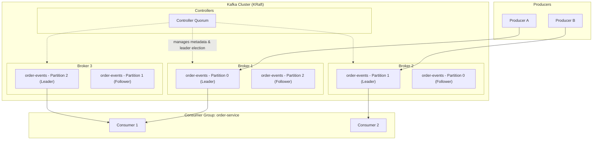

import FundamentalsQuestions from './_partials/01-fundamentals-questions.mdx';

# Kafka Fundamentals

Kafka questions show up in almost every backend interview involving distributed systems, and
most candidates can define "topic" and "partition" but fall apart the moment they're asked
*why* the architecture is shaped this way. This page builds the mental model everything else in
this section depends on.

## What Kafka actually is

Kafka is a distributed, append-only commit log. That single sentence explains most of its
design decisions. It is not a message queue in the traditional sense (like RabbitMQ or ActiveMQ):
messages aren't removed once consumed, consumers don't compete for individual messages in the
way a queue's workers do, and ordering guarantees come from log structure, not from broker-side
message locking.

Kafka is used for:

- **Event streaming** between microservices (order placed, payment processed, inventory updated).
- **Decoupling producers from consumers** in time and in deployment.
- **Durable buffering** so slow or temporarily-down consumers don't cause data loss.
- **Replayability** &mdash; a new consumer can read the entire history of a topic from the beginning.

## Core building blocks

### Brokers

A **broker** is a single Kafka server process. A Kafka **cluster** is a set of brokers working
together. Each broker hosts a subset of partitions for the topics in the cluster and handles
reads/writes for the partitions it's responsible for (see [Replication and ISR](./05-replication-and-isr.md)
for how leadership is assigned).

### Topics and partitions

A **topic** is a named stream of records (e.g. `order-events`). Topics are split into
**partitions** &mdash; this is the actual unit of parallelism and ordering in Kafka.

- Ordering is only guaranteed **within a single partition**, never across an entire topic.
- Each record in a partition gets a monotonically increasing **offset**, its position in that
  partition's log.
- The number of partitions a topic has determines the maximum number of consumers within a
  single consumer group that can read from it in parallel &mdash; one partition can only be
  actively read by one consumer per group at a time.

This is the detail interviewers probe most: **if you need strict ordering for a given entity
(e.g. all events for order #123), you must ensure they land in the same partition**, typically
by keying messages on that entity's ID.

### Producers and consumers

- **Producers** write records to topics. A producer chooses (or lets a partitioner choose) which
  partition a record goes to.
- **Consumers** read records from topics, tracking their position via **offsets**. Consumers are
  organized into **consumer groups** for scalable, coordinated consumption (covered in depth in
  [Consumers and Groups](./03-consumer-and-groups.md)).

### Offsets

An offset is just an integer index into a partition's log. Kafka retains committed offsets per
consumer group so that a consumer (or its replacement, after a crash or rebalance) knows where
to resume reading. Offsets are **not** deleted when read &mdash; the log persists based on a
retention policy (time-based or size-based), independent of consumption.

## Zookeeper vs. KRaft

This is one of the most common "do you know what's actually changed in Kafka recently" questions.

**Historically (pre-2.8, and the default until 3.x):** Kafka depended on **Apache Zookeeper** as
an external coordination service. Zookeeper stored cluster metadata (which brokers exist, topic
configs, ACLs) and handled **controller election** &mdash; picking which broker acts as the
cluster controller responsible for partition leader election and metadata propagation.

**KRaft (Kafka Raft metadata mode), production-ready since Kafka 3.3+ and mandatory since Kafka
4.0 (Zookeeper support was removed):** Kafka manages its own metadata using a Raft consensus
protocol implemented internally, with a subset of brokers acting as **controllers**. This removes
the external Zookeeper dependency entirely.

Why this matters beyond trivia:

- **Operational simplicity** &mdash; one system to deploy and monitor instead of two.
- **Faster controller failover** &mdash; Zookeeper-based controller re-election could take seconds
  under load; KRaft's Raft-based approach is designed to fail over in a bounded, much shorter time.
- **Higher partition-count scalability** &mdash; Zookeeper became a bottleneck for clusters with
  hundreds of thousands of partitions since metadata operations were serialized through it.

If asked "does Kafka still use Zookeeper," the accurate answer as of Kafka 4.0 is: no, Zookeeper
has been removed and KRaft is the only supported metadata mode.

## Architecture diagram



## A minimal producer/consumer in Spring Boot

```java
// application.yml equivalent shown as properties for clarity
@Configuration
public class KafkaTopicConfig {

    @Bean
    public NewTopic orderEventsTopic() {
        return TopicBuilder.name("order-events")
                .partitions(6)
                .replicas(3)
                .build();
    }
}
```

```java
@Service
@RequiredArgsConstructor
public class OrderEventPublisher {

    private final KafkaTemplate<String, OrderEvent> kafkaTemplate;

    public void publish(OrderEvent event) {
        // Keying by orderId guarantees all events for the same order
        // land in the same partition, preserving per-order ordering.
        kafkaTemplate.send("order-events", event.getOrderId(), event);
    }
}
```

```java
@Component
public class OrderEventListener {

    @KafkaListener(topics = "order-events", groupId = "order-service")
    public void handle(OrderEvent event) {
        // process the event
    }
}
```

:::info Interview Questions
<FundamentalsQuestions/>
:::
