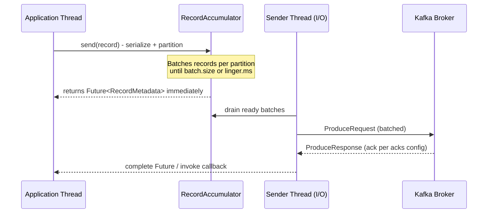

# Producer Internals

Producer configuration is where most "we lost messages in production" incidents trace back to.
Interviewers use this topic to check whether you actually understand the tradeoffs behind
`acks`, batching, and idempotency &mdash; not just whether you can name the properties.

## The send pipeline

Calling `kafkaTemplate.send(...)` does not synchronously write to a broker. It goes through a
pipeline:

1. **Serialization** &mdash; key and value are serialized (e.g. via `StringSerializer`,
   `JsonSerializer`, or Avro/Protobuf serializers backed by a schema registry).
2. **Partitioning** &mdash; the partitioner decides which partition the record goes to.
3. **Accumulation (batching)** &mdash; the record is appended to an in-memory buffer for its
   destination partition, held in the `RecordAccumulator`.
4. **Sender thread** &mdash; a background I/O thread drains batches from the accumulator and
   sends them to the appropriate broker as a single network request per broker (not per record).
5. **Broker acknowledgment** &mdash; the broker responds according to the `acks` setting, and the
   producer's callback/future is completed.

This is why Kafka producers achieve high throughput despite network round-trips: many individual
`send()` calls are coalesced into a small number of batched network requests.



## Batching: `batch.size` and `linger.ms`

- **`batch.size`** (bytes, default 16KB) &mdash; the max size of a batch per partition before it's
  considered "full" and eligible to send.
- **`linger.ms`** (default 0) &mdash; how long the producer will wait, hoping more records arrive
  to fill the batch, before sending it anyway even if not full.

Setting `linger.ms` above 0 trades a small amount of latency for significantly higher throughput,
because larger batches mean fewer, more efficient network requests and less per-request overhead
(and better compression ratios, if compression is enabled). This is a classic latency-vs-throughput
tradeoff interviewers like to probe: "would you set `linger.ms` to 0 for a high-throughput event
pipeline?" &mdash; no, you'd raise it.

## `acks`: the durability knob

`acks` controls how many replicas must acknowledge a write before the producer considers it
successful:

| Value | Meaning | Durability | Throughput |
|---|---|---|---|
| `acks=0` | Producer doesn't wait for any broker response | Weakest &mdash; records can be silently lost | Highest |
| `acks=1` | Only the partition leader must persist the record | Lost if leader crashes before followers replicate it | Medium |
| `acks=all` (`-1`) | All in-sync replicas (per `min.insync.replicas`) must persist it | Strongest, no data loss as long as enough replicas survive | Lowest (relatively) |

`acks=all` combined with `min.insync.replicas` (see [Replication and ISR](./05-replication-and-isr.md))
is the standard configuration for anything where losing a message is unacceptable, e.g. payment
events.

## The partitioner

When a record has a key, the default partitioner hashes the key (murmur2) to consistently map it
to the same partition &mdash; this is *how* per-key ordering is achieved. When a record has no
key, the default "sticky" partitioner batches multiple key-less records onto the same randomly
chosen partition until the batch is sent, then picks a new one, improving batching efficiency
compared to naive round-robin.

You can implement a custom `Partitioner` when you need non-default routing logic (e.g. routing
by tenant ID to a fixed subset of partitions for resource isolation).

## Idempotent producer

Without idempotency, a producer retry (e.g. after a network timeout where the broker actually
received and wrote the record but the ack was lost) can cause **duplicate writes** to a partition.

Setting `enable.idempotence=true` (default `true` since Kafka 3.0 when other settings allow it)
makes the producer assign each batch a **Producer ID (PID)** and a **sequence number** per
partition. The broker tracks the last sequence number written per PID/partition and rejects
(deduplicates) a retry that would otherwise create a duplicate. This gives you **exactly-once
delivery within a single producer session, per partition** &mdash; not exactly-once across the
whole pipeline (see [Delivery Semantics](./04-delivery-semantics.md) for that distinction).

Idempotent producers require:
- `acks=all`
- `max.in.flight.requests.per.connection <= 5` (to preserve batch ordering guarantees during retries)
- `retries > 0`

Spring Kafka and the Java client set these compatible defaults automatically when idempotence is
enabled.

## Producer configuration in Spring Boot

```yaml
spring:
  kafka:
    producer:
      bootstrap-servers: localhost:9092
      key-serializer: org.apache.kafka.common.serialization.StringSerializer
      value-serializer: org.springframework.kafka.support.serializer.JsonSerializer
      acks: all
      properties:
        enable.idempotence: true
        linger.ms: 20
        batch.size: 32768
        compression.type: lz4
        max.in.flight.requests.per.connection: 5
```

```java
@Service
@RequiredArgsConstructor
public class PaymentEventPublisher {

    private final KafkaTemplate<String, PaymentEvent> kafkaTemplate;

    public CompletableFuture<SendResult<String, PaymentEvent>> publish(PaymentEvent event) {
        return kafkaTemplate.send("payment-events", event.getPaymentId(), event)
                .whenComplete((result, ex) -> {
                    if (ex != null) {
                        // The idempotent producer already retried internally;
                        // reaching here means retries were exhausted.
                        log.error("Failed to publish payment event {}", event.getPaymentId(), ex);
                    }
                });
    }
}
```

:::info Interview Questions
- Walk through what happens internally between calling `send()` and a record actually reaching the broker.
- What's the tradeoff of increasing `linger.ms`, and when would you do it?
- What are the durability differences between `acks=0`, `acks=1`, and `acks=all`?
- How does the default partitioner decide where a keyed record goes, versus a key-less one?
- What problem does the idempotent producer solve, and what configuration does it require?
- Does an idempotent producer give you exactly-once semantics end-to-end? Why or why not?
:::
