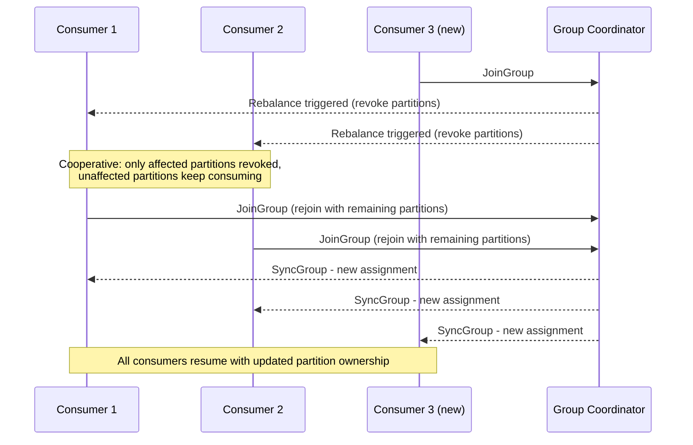

# Consumers and Consumer Groups

Rebalancing bugs and offset-management mistakes are two of the most common Kafka production
incidents, and both trace back to a shaky understanding of consumer group mechanics. This is
consistently one of the deepest topics interviewers dig into.

## Consumer groups: the scaling unit

A **consumer group** is a set of consumers that cooperate to consume a topic, identified by a
shared `group.id`. Kafka guarantees that **each partition is consumed by at most one consumer
within a given group at any time** &mdash; this is what makes consumer groups the mechanism for
horizontal scaling of consumption.

- If you have 6 partitions and 3 consumers in a group, each consumer gets 2 partitions.
- If you add a 4th consumer, partitions are **rebalanced** to spread across all 4.
- If you have more consumers than partitions, the extra consumers sit idle &mdash; this is a
  common capacity-planning question ("why isn't my new pod processing anything?").
- Different consumer groups are entirely independent: two groups reading the same topic each get
  their own full view of every partition.

## Rebalancing

A **rebalance** is the process of redistributing partition ownership across the consumers in a
group. It's triggered by:

- A consumer joining or leaving the group (including crashes detected via missed heartbeats).
- A consumer failing to call `poll()` within `max.poll.interval.ms` (treated as dead/stuck).
- Topic metadata changes (e.g. partitions added).

### Eager vs. cooperative rebalancing

- **Eager rebalancing** (the historical default): **all** consumers in the group give up **all**
  their partitions ("stop the world"), then partitions are reassigned from scratch. Every
  consumer pauses processing during this window, even ones unaffected by the membership change.
- **Cooperative (incremental) rebalancing** (`CooperativeStickyAssignor`, recommended default in
  modern clients): only the specific partitions that need to move are revoked, over two
  rebalance phases. Consumers keep processing their unaffected partitions the whole time. This
  drastically reduces the "rebalancing storm" pause under frequent membership churn (see
  [Common Pitfalls](./07-common-pitfalls.md)).



## Partition assignment strategies

Configured via `partition.assignment.strategy`:

- **RangeAssignor** (older default): assigns contiguous partition ranges per topic to consumers
  sorted by name. Can produce uneven load across consumers when a group consumes multiple topics.
- **RoundRobinAssignor**: spreads all partitions across all consumers round-robin, generally more
  even, but still eager (full stop-the-world rebalance).
- **StickyAssignor**: like round-robin's balance, but minimizes partition movement between
  rebalances (a consumer keeps most of what it had before), reducing state-rebuild cost for
  stateful consumers.
- **CooperativeStickyAssignor**: sticky assignment *and* cooperative (incremental) rebalancing.
  This is the generally recommended choice for new applications.

## Offset management: auto vs. manual commit

The consumer tracks its position by committing offsets back to Kafka (in the internal
`__consumer_offsets` topic).

### Auto-commit

With `enable.auto.commit=true` (the default), offsets are committed automatically on a timer
(`auto.commit.interval.ms`, default 5s), based on what's been returned by `poll()` &mdash;
**not** based on whether your code actually finished processing those records. This is the root
cause of a very common bug: if your consumer crashes mid-processing after an auto-commit has
already fired for records it hasn't finished handling, those records are silently skipped on
restart.

### Manual commit

Disabling auto-commit (`enable.auto.commit=false`) and committing explicitly after successful
processing gives you control over the at-least-once guarantee:

```java
@Component
@RequiredArgsConstructor
public class InventoryEventListener {

    @KafkaListener(
            topics = "inventory-events",
            groupId = "inventory-service",
            containerFactory = "manualAckContainerFactory")
    public void handle(ConsumerRecord<String, InventoryEvent> record, Acknowledgment ack) {
        try {
            processInventoryUpdate(record.value());
            ack.acknowledge(); // commits offset only after successful processing
        } catch (Exception ex) {
            log.error("Failed to process inventory event, offset not committed", ex);
            // record will be redelivered on next poll/rebalance
            throw ex;
        }
    }
}
```

```java
@Configuration
public class KafkaConsumerConfig {

    @Bean
    public ConcurrentKafkaListenerContainerFactory<String, InventoryEvent> manualAckContainerFactory(
            ConsumerFactory<String, InventoryEvent> consumerFactory) {
        var factory = new ConcurrentKafkaListenerContainerFactory<String, InventoryEvent>();
        factory.setConsumerFactory(consumerFactory);
        factory.getContainerProperties().setAckMode(ContainerProperties.AckMode.MANUAL);
        return factory;
    }
}
```

Committing **too early** (before processing completes) risks message loss on crash. Committing
**too late**, or batching commits infrequently, increases the number of records reprocessed after
a crash or rebalance &mdash; you're tuning the size of the "at-least-once" redelivery window, not
eliminating it.

:::info Interview Questions
- What guarantee does a consumer group provide about which consumer reads a given partition?
- What happens if you have more consumers in a group than partitions on the topic?
- What's the difference between eager and cooperative (incremental) rebalancing, and why does it matter operationally?
- What triggers a consumer rebalance?
- Why can auto-commit cause message loss, even though Kafka is often described as at-least-once?
- How does `StickyAssignor` reduce the cost of a rebalance compared to `RangeAssignor`?
- If you commit offsets before finishing processing versus after, what failure mode does each risk?
:::
