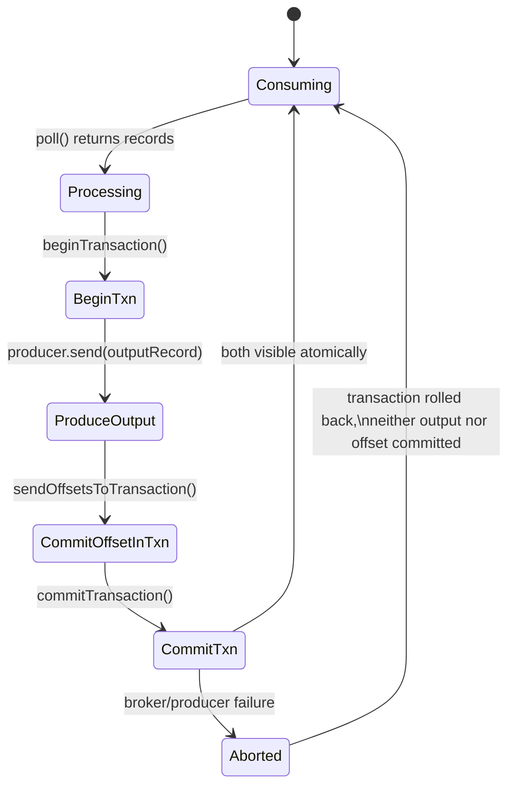

# Delivery Semantics

"What delivery guarantee does Kafka provide?" is a near-universal interview question, and the
honest answer is "it depends on how you configure both the producer and the consumer." This page
walks through each guarantee with concrete failure scenarios, because the definitions alone don't
demonstrate understanding &mdash; being able to describe *how* a failure produces duplication or
loss does.

## At-most-once

A record is delivered **zero or one times** &mdash; it may be lost, but never processed twice.

**How you get this:** commit consumer offsets *before* processing the record (or use aggressive
auto-commit with no retry-on-failure logic).

**Concrete failure scenario:** the consumer polls a batch, commits offsets immediately, then
crashes while processing record #5. On restart, the consumer resumes from the committed offset
&mdash; **past** record #5 &mdash; so it's never processed. Data is silently lost, but nothing is
ever duplicated.

This is rarely desirable, but appropriate for things like periodic metrics/telemetry ingestion
where occasional loss is acceptable and duplication would skew data more than loss would.

## At-least-once

A record is delivered **one or more times** &mdash; it is never lost, but may be processed
multiple times.

**How you get this:** commit consumer offsets *after* successful processing (manual ack, as
shown in [Consumers and Groups](./03-consumer-and-groups.md)), combined with producer retries.

**Concrete failure scenario:** the consumer processes record #5 successfully (e.g. writes to a
database and sends a confirmation email), but crashes **before** committing the offset. On
restart, it resumes from the last committed offset &mdash; **before** record #5 &mdash; so
record #5 is processed again, potentially sending a duplicate email or double-charging a
customer. This is why at-least-once consumers must be paired with **idempotent processing logic**
(e.g. the [Inbox Pattern](./06-outbox-and-inbox-pattern.md)) if duplicates are unacceptable.

This is Kafka's most common configuration in production, because it's the safest default that
doesn't lose data, provided the consumer-side logic is written to tolerate duplicates.

## Exactly-once semantics (EOS)

A record is delivered and processed **exactly one time**, with no loss and no duplication, from
the consumer's point of view.

Kafka achieves this **within Kafka** (i.e. for read-process-write pipelines where you consume
from one topic and produce to another, entirely within Kafka) via **transactions**:

1. The producer is configured as a **transactional producer** (`transactional.id` set).
2. `producer.beginTransaction()` starts a transaction.
3. The producer writes output records **and** commits input consumer offsets **as part of the
   same transaction**, via `producer.sendOffsetsToTransaction(offsets, groupMetadata)`.
4. `producer.commitTransaction()` atomically makes both the produced records and the consumed
   offsets visible together &mdash; consumers reading with `isolation.level=read_committed` will
   never see the produced records unless the offset commit also succeeded, and vice versa.

**Concrete failure scenario this solves:** without transactions, a consume-transform-produce
service could produce its output record, then crash before committing the input offset. On
restart, it would reprocess the input record and produce a **duplicate** output record. Kafka
transactions make the "produce output + commit input offset" step atomic, so this can't happen.

**The critical caveat interviewers want to hear:** Kafka's exactly-once guarantee is only
end-to-end when **every hop stays inside Kafka**. The moment your pipeline writes to an external
system &mdash; a database, an HTTP call, a third-party API &mdash; Kafka's transactions can't make
that external write atomic with the offset commit. For that, you need patterns like transactional
outbox/inbox (see [Outbox and Inbox Pattern](./06-outbox-and-inbox-pattern.md)) or idempotent
external writes keyed by a unique message ID.



## Configuration comparison

| Guarantee | Producer config | Consumer config |
|---|---|---|
| At-most-once | any | auto-commit before processing, or commit-then-process |
| At-least-once | `acks=all`, retries enabled | manual commit after successful processing |
| Exactly-once (intra-Kafka) | `transactional.id` set, idempotence enabled | `isolation.level=read_committed`, offsets committed via transaction |

## Spring Kafka: transactional read-process-write

```yaml
spring:
  kafka:
    producer:
      transaction-id-prefix: order-service-tx-
    consumer:
      properties:
        isolation.level: read_committed
    listener:
      ack-mode: manual
```

```java
@Component
@RequiredArgsConstructor
public class OrderEnrichmentProcessor {

    private final KafkaTemplate<String, EnrichedOrder> kafkaTemplate;

    // @Transactional here coordinates with the KafkaTransactionManager so the
    // outbound send and the inbound offset commit happen atomically.
    @KafkaListener(topics = "raw-orders", groupId = "order-enrichment")
    @Transactional
    public void enrichAndForward(RawOrder rawOrder) {
        EnrichedOrder enriched = enrich(rawOrder);
        kafkaTemplate.send("enriched-orders", enriched.getOrderId(), enriched);
    }
}
```

:::info Interview Questions
- Describe a concrete scenario where at-most-once delivery results in data loss.
- Describe a concrete scenario where at-least-once delivery results in duplicate processing.
- How does Kafka implement exactly-once semantics for a consume-transform-produce pipeline?
- Why is Kafka's exactly-once guarantee limited to "within Kafka," and what breaks it?
- What does `isolation.level=read_committed` actually change about what a consumer sees?
- If your pipeline writes to an external database as its final step, how would you achieve effectively-once behavior?
:::
