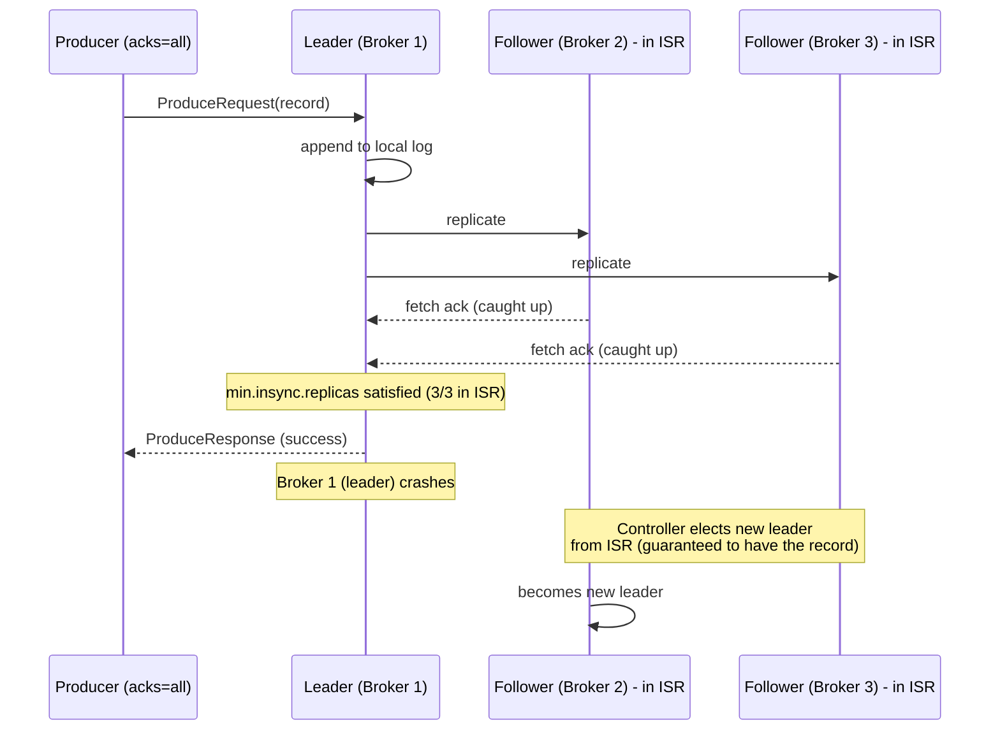

# Replication and ISR

Replication is how Kafka survives broker failures without losing data, and it's the mechanism
behind `acks=all` actually meaning something. Interviewers use this topic to test whether you
understand *why* a replication factor of 3 with `min.insync.replicas=2` is the standard
production baseline, not just that "more replicas is safer."

## Replication factor

Every partition can have multiple **replicas** &mdash; full copies of that partition's log,
each stored on a different broker. **Replication factor (RF)** is the total number of copies,
including the leader.

- RF=1 means no redundancy: lose that broker, lose the partition's data.
- RF=3 is the common production default: the partition survives the loss of up to 2 brokers
  (though see `min.insync.replicas` below for what "surviving" means for write availability).

One replica is elected the **leader**; all producer writes and consumer reads go through the
leader. The other replicas are **followers**, which continuously fetch new records from the
leader to stay in sync &mdash; they don't serve client traffic directly (with the exception of
newer "follower fetching" / rack-aware read features in some deployments, which is an
optimization on top of this base model, not a replacement for it).

## In-Sync Replicas (ISR)

The **ISR** is the set of replicas (including the leader) that are **caught up** with the leader
&mdash; i.e. have replicated all records up to a recent point, within `replica.lag.time.max.ms`.
A follower falls out of the ISR if it lags behind for longer than that threshold (e.g. due to a
slow disk, network partition, or GC pause), and is added back once it catches up.

This matters because **`acks=all` means "all replicas currently in the ISR," not "all replicas
that nominally exist for this partition."** If a partition has RF=3 but one follower has fallen
out of the ISR, `acks=all` only needs the remaining 2 ISR members to acknowledge.

## `min.insync.replicas`

This is the setting that gives `acks=all` real teeth. `min.insync.replicas` (set at the topic or
broker level) specifies the **minimum ISR size required for a write to succeed** when
`acks=all` is used.

**Concrete scenario:** RF=3, `min.insync.replicas=2`.

- Normally: leader + 2 followers are all in the ISR (ISR size 3). Writes succeed, acknowledged
  once at least 2 of the 3 (including the leader) persist the record.
- One follower falls out of the ISR (e.g. broker is slow or down): ISR size drops to 2. Writes
  **still succeed**, since ISR size (2) still meets `min.insync.replicas` (2).
- A second follower also falls out of the ISR: ISR size drops to 1 (just the leader).
  `min.insync.replicas=2` is no longer satisfied, so **the producer receives a
  `NotEnoughReplicasException` and the write is rejected** &mdash; Kafka refuses to accept writes
  it can't durably replicate, rather than silently accepting a write that only exists on one
  broker.

This is a deliberate **availability-for-durability tradeoff**: with RF=3 and
`min.insync.replicas=2`, you can tolerate the loss of 1 broker with zero impact on writes, but
losing a 2nd simultaneously stops writes rather than risking data durability. Setting
`min.insync.replicas` equal to RF removes all fault tolerance for writes; setting it to 1 removes
the durability protection `acks=all` is meant to provide.

## Leader election

When a partition's leader broker fails, one of the remaining **in-sync** replicas is elected as
the new leader (coordinated via the controller/KRaft quorum, see
[Fundamentals](./01-fundamentals.md)). Because the new leader is guaranteed to have been in the
ISR, it has all records that were acknowledged under `acks=all` &mdash; no acknowledged data is
lost in the failover.

If `unclean.leader.election.enable=true` (not the default, and generally discouraged in
production), Kafka is allowed to elect an **out-of-sync** replica as leader when no in-sync
replica is available, trading data loss for availability &mdash; some already-acknowledged
records may not exist on that replica and are effectively lost. This flag is a classic interview
trick question: "would you enable unclean leader election for a payments topic?" &mdash; no, you'd
rather the partition be unavailable than silently lose committed financial data.



## Practical configuration

```properties
# topic-level config, e.g. via kafka-topics.sh or NewTopic bean
replication.factor=3
min.insync.replicas=2
unclean.leader.election.enable=false
```

```java
@Bean
public NewTopic paymentEventsTopic() {
    return TopicBuilder.name("payment-events")
            .partitions(12)
            .replicas(3)
            .config("min.insync.replicas", "2")
            .config("unclean.leader.election.enable", "false")
            .build();
}
```

:::info Interview Questions
- What's the difference between replication factor and ISR size?
- What exactly does `acks=all` wait for, precisely?
- With RF=3 and `min.insync.replicas=2`, how many broker failures can occur before writes start failing, and why?
- What happens to a producer's write if the ISR shrinks below `min.insync.replicas`?
- Why would you avoid enabling `unclean.leader.election.enable` for a financial data topic?
- How is a new partition leader chosen after the current leader fails, and why doesn't this cause data loss for acknowledged writes?
:::
