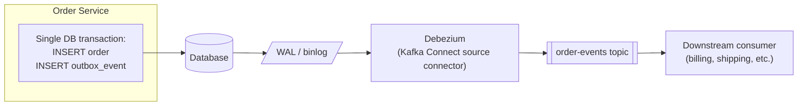
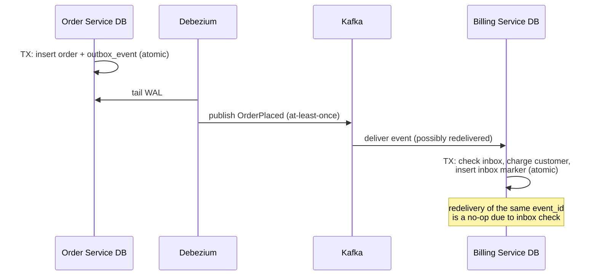

# Outbox and Inbox Patterns

This is where [Delivery Semantics](./04-delivery-semantics.md) meets real system design. The
"dual write problem" &mdash; writing to your database and publishing a Kafka event as two
separate operations &mdash; is one of the most common sources of data inconsistency in
event-driven systems, and the Outbox/Inbox patterns are the standard answer. Interviewers ask
about this constantly because it tests whether you can reason about atomicity across two
different systems.

## The dual write problem

Consider a typical "place order" flow:

```java
@Transactional
public void placeOrder(Order order) {
    orderRepository.save(order);                 // write #1: database
    kafkaTemplate.send("order-events", order);    // write #2: Kafka
}
```

These are two independent systems with no shared transaction. Every ordering of failure is
possible:

- The database commit succeeds, then the process crashes before the Kafka send &mdash; the order
  exists, but no event is ever published. Downstream systems (billing, shipping) never find out.
- The Kafka send succeeds, but the database transaction then rolls back (e.g. a later validation
  fails) &mdash; an event is published for an order that doesn't actually exist.

`@Transactional` only protects the database write. It has no effect on the Kafka call.

## The Outbox Pattern

The fix: **never write to Kafka directly from the request path.** Instead, write the event to an
**outbox table in the same database transaction** as the business data, then publish it to Kafka
asynchronously, afterward.

```sql
CREATE TABLE outbox_events (
    id UUID PRIMARY KEY,
    aggregate_type VARCHAR(255) NOT NULL,
    aggregate_id VARCHAR(255) NOT NULL,
    event_type VARCHAR(255) NOT NULL,
    payload JSONB NOT NULL,
    created_at TIMESTAMP NOT NULL DEFAULT now(),
    published BOOLEAN NOT NULL DEFAULT false
);
```

```java
@Transactional
public void placeOrder(Order order) {
    orderRepository.save(order);
    outboxRepository.save(OutboxEvent.builder()
            .aggregateType("Order")
            .aggregateId(order.getId())
            .eventType("OrderPlaced")
            .payload(toJson(order))
            .build());
    // Both writes commit or roll back together - same DB transaction.
}
```

Because both inserts are in the same database transaction, they're atomic: either both the order
and its outbox event exist, or neither does. There is no window where one exists without the
other.

### Getting events from the outbox table to Kafka

**Option 1: Polling publisher.** A scheduled job polls `outbox_events WHERE published = false`,
publishes each row to Kafka, and marks it published (or deletes it) after a successful send.

```java
@Scheduled(fixedDelay = 500)
public void publishPendingEvents() {
    List<OutboxEvent> pending = outboxRepository.findByPublishedFalseOrderByCreatedAtAsc();
    for (OutboxEvent event : pending) {
        kafkaTemplate.send(topicFor(event), event.getAggregateId(), event.getPayload())
                .whenComplete((result, ex) -> {
                    if (ex == null) {
                        outboxRepository.markPublished(event.getId());
                    }
                });
    }
}
```

Simple to implement, but adds polling latency and load on the database, and needs care around
concurrent pollers (e.g. multiple service instances) double-publishing &mdash; usually solved
with `SELECT ... FOR UPDATE SKIP LOCKED` or a single designated publisher instance.

**Option 2: Change Data Capture (CDC) via Debezium.** Debezium reads the database's write-ahead
log (e.g. Postgres's WAL, MySQL's binlog) directly and streams row changes on the outbox table to
Kafka in near real-time, with no polling and no extra load on the primary database from
application-level queries.

This is the more common production approach at scale: lower latency, no polling overhead, and
the capture mechanism is decoupled from application code entirely (Debezium runs as a Kafka
Connect source connector).



## The Inbox Pattern

The Outbox Pattern solves atomic *publishing*. But per
[Delivery Semantics](./04-delivery-semantics.md), Kafka consumers are typically at-least-once
&mdash; the same event can be delivered more than once (e.g. after a consumer crash between
processing and offset commit, or a rebalance). If processing an event has a side effect that
isn't naturally idempotent (charging a card, sending an email, incrementing a counter),
duplicate delivery causes duplicate side effects.

The **Inbox Pattern** makes consumption idempotent: track which event IDs have already been
processed, in the same database transaction as the business-logic side effect.

```sql
CREATE TABLE inbox_processed_events (
    event_id UUID PRIMARY KEY,
    processed_at TIMESTAMP NOT NULL DEFAULT now()
);
```

```java
@KafkaListener(topics = "order-events", groupId = "billing-service")
@Transactional
public void handleOrderPlaced(OrderPlacedEvent event) {
    if (inboxRepository.existsById(event.getEventId())) {
        // Already processed - safe to skip. This is what makes redelivery harmless.
        return;
    }
    billingService.chargeCustomer(event.getOrderId(), event.getAmount());
    inboxRepository.save(new InboxProcessedEvent(event.getEventId()));
    // Business side effect + inbox marker committed together.
}
```

Every event needs a stable, unique **event ID** (generated once, at the outbox-write step, and
carried through unchanged) for this deduplication check to work &mdash; if you regenerate an ID
on every publish attempt, retried publishes look like new events and the inbox check is useless.

## Outbox + Inbox together: effectively-once across service boundaries

Combining both patterns gets you **effectively-once processing** across two independently-owned
databases, without relying on distributed transactions (2PC) between them:



:::info Interview Questions
- What is the "dual write problem," and why doesn't wrapping both writes in `@Transactional` solve it?
- Walk through how the Outbox Pattern guarantees an event is published if and only if the related DB change committed.
- What's the tradeoff between a polling publisher and CDC (Debezium) for reading the outbox table?
- Why is the Outbox Pattern alone not enough to prevent duplicate side effects on the consumer side?
- How does the Inbox Pattern achieve idempotent processing, and what has to be true about the event ID for it to work?
- How would you achieve effectively-once processing across two services that each own their own database, without distributed transactions?
:::
