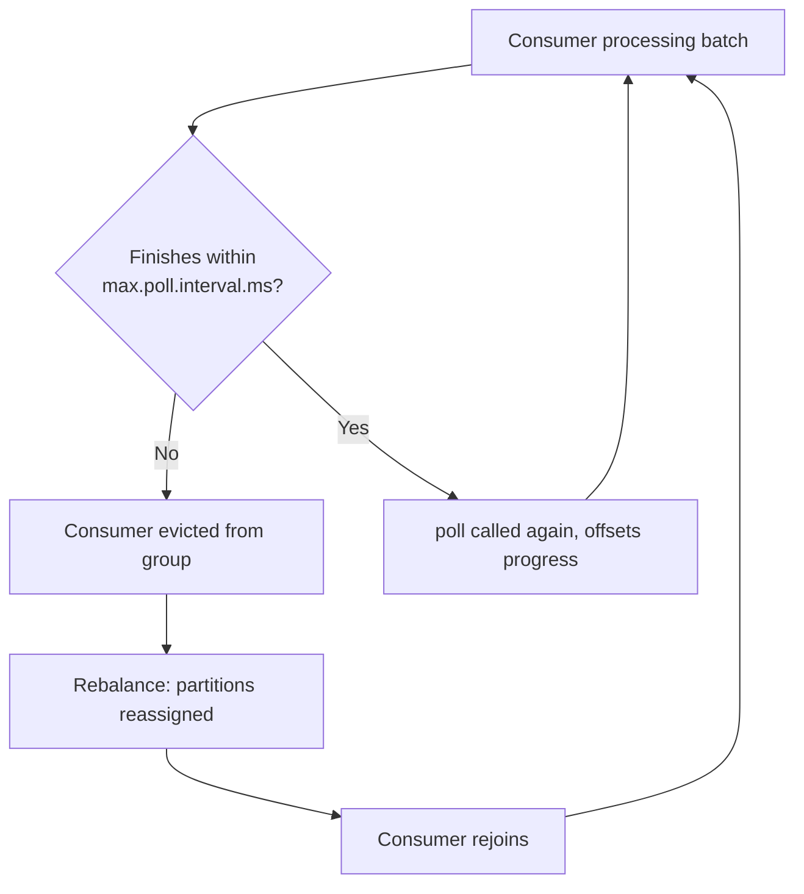

import CommonPitfallsQuestions from './_partials/07-common-pitfalls-questions.mdx';

# Common Pitfalls

This page ties together the previous topics through the lens of what actually breaks in
production. These are the scenarios interviewers use as follow-ups to "so you know the theory
&mdash; now debug this" style questions.

## Rebalancing storms

A **rebalancing storm** is when a consumer group enters a repeated cycle of rebalances, often
triggered by consumers being kicked out of the group and immediately trying to rejoin, which
triggers another rebalance, and so on &mdash; during which little or no actual message processing
happens.

**Common causes:**

- **Slow processing exceeding `max.poll.interval.ms`** (default 5 minutes): if your
  `@KafkaListener` method takes too long per batch (e.g. a slow downstream HTTP call per record),
  the consumer is considered dead and evicted, even though its heartbeat thread is still alive.
  It rejoins, gets partitions reassigned, and can hit the same slow path again.
- **Undersized thread pools / GC pauses** blocking the poll loop long enough to miss the interval.
- **Frequent pod restarts/autoscaling** in Kubernetes deployments, especially with eager
  rebalancing where every restart pauses the *entire* group, not just the affected consumer.

**Mitigations:**

- Use `CooperativeStickyAssignor` (see [Consumers and Groups](./03-consumer-and-groups.md)) so
  membership churn doesn't pause unaffected consumers.
- Lower `max.poll.records` so each `poll()` batch is smaller and finishes well within
  `max.poll.interval.ms`.
- Move genuinely slow per-record work off the poll thread (e.g. hand off to a bounded worker
  pool) rather than doing it inline in the listener &mdash; carefully, since this changes your
  offset-commit and ordering guarantees and needs to be done deliberately, not as a quick fix.
- Tune `session.timeout.ms` and `heartbeat.interval.ms` deliberately rather than leaving defaults
  that don't match your actual processing time.



## Poison pill messages

A **poison pill** is a message that a consumer can never successfully process &mdash; e.g. it
fails deserialization (schema mismatch), or it triggers an unhandled exception in business logic
every single time it's retried.

**Why it's dangerous:** with manual-commit, at-least-once processing, a naive implementation
re-throws on failure so the offset never advances, expecting the message to be retried. But if
the message *itself* is the problem, it will fail identically forever &mdash; the consumer gets
stuck reprocessing the same offset in a tight loop, and **every message behind it in that
partition is blocked**, since offsets are strictly ordered per partition.

**Mitigations:**

- **Dead Letter Topic (DLT):** after N retries, publish the failing record (plus failure metadata)
  to a separate `*-dlt` topic and commit the original offset, so the partition can keep moving.
  Spring Kafka supports this out of the box via `DefaultErrorHandler` with a
  `DeadLetterPublishingRecoverer`.
- Distinguish **retryable** failures (e.g. a downstream service timeout &mdash; retry makes
  sense) from **non-retryable** failures (e.g. malformed payload &mdash; retrying is pointless)
  in your exception handling, and route accordingly.

```java
@Configuration
public class KafkaErrorHandlingConfig {

    @Bean
    public DefaultErrorHandler errorHandler(KafkaTemplate<String, Object> template) {
        var recoverer = new DeadLetterPublishingRecoverer(template,
                (record, ex) -> new TopicPartition(record.topic() + "-dlt", record.partition()));

        // Retry transient failures 3 times with backoff, then send to DLT.
        var errorHandler = new DefaultErrorHandler(recoverer, new FixedBackOff(1000L, 3));
        errorHandler.addNotRetryableExceptions(DeserializationException.class, IllegalArgumentException.class);
        return errorHandler;
    }
}
```

## Consumer lag

**Consumer lag** is the difference between the latest offset produced to a partition and the
last offset committed by a consumer group &mdash; i.e. how far behind the consumer is. It's the
single most important Kafka health metric to monitor, exposed via tools like Kafka's
`kafka-consumer-groups.sh --describe` or, more commonly, Burrow / Prometheus exporters feeding a
Grafana dashboard.

**Common causes of growing lag:**

- Consumer throughput genuinely can't keep up with produce rate (undersized consumer group
  relative to partition count/traffic).
- Slow per-record processing (e.g. a synchronous external call per message).
- Frequent rebalances eating into actual processing time (see above).
- A single slow/stuck partition holding up progress while its assigned consumer struggles,
  even if other partitions in the same topic are fine.

**Why this matters in an interview context:** lag is a leading indicator, not just a monitoring
curiosity. Rising lag on a topic feeding a customer-facing feature (e.g. order status updates)
directly translates into user-visible staleness. Being asked "how would you diagnose rising
consumer lag" is really asking whether you know to check: partition count vs. consumer count,
per-record processing time, and rebalance frequency, in that order.

## Duplicate processing

This ties directly back to [Delivery Semantics](./04-delivery-semantics.md): at-least-once
delivery (the common, safe default) means duplicates **will** happen &mdash; not as an edge case,
but as an expected, ordinary occurrence, from producer retries, consumer redelivery after a
crash, or rebalances.

**The fix is never "try to prevent duplicates from Kafka's side."** It's to make processing
**idempotent** on the consumer side, so a duplicate delivery is harmless:

- Use the [Inbox Pattern](./06-outbox-and-inbox-pattern.md) for side effects with a durable event
  ID.
- Use **natural idempotency keys** where available &mdash; e.g. an upsert keyed on a unique
  business ID (`INSERT ... ON CONFLICT (order_id) DO UPDATE`) instead of a blind insert.
- For external API calls, pass an idempotency key the downstream API supports (many payment
  providers, e.g., accept an `Idempotency-Key` header for exactly this reason).

Treating "duplicates shouldn't happen" as the goal, instead of "duplicates should be harmless
when they happen," is the most common design mistake interviewers look for here.

:::info Interview Questions
<CommonPitfallsQuestions/>
:::
