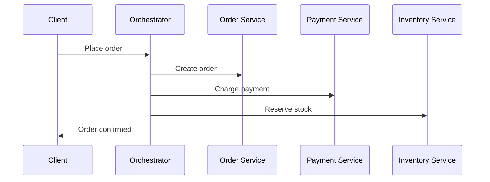

import ServiceCommunicationQuestions from './_partials/02-service-communication-questions.mdx';

# Service Communication

Once a system is split into services, how they talk to each other becomes the central design
decision &mdash; it shapes coupling, latency, and failure behavior more than almost anything else.
This page covers the sync-vs-async axis and the orchestration-vs-choreography axis, which together
explain most of the communication patterns that show up in interviews.

## Synchronous vs. asynchronous communication

- **Synchronous** communication: the caller sends a request and blocks waiting for a response
  before continuing (HTTP/REST, gRPC). Simple to reason about &mdash; it behaves like a function
  call &mdash; but it couples the caller's availability to the callee's: if the callee is slow or
  down, the caller is too, and calling several services synchronously in sequence stacks their
  latencies and failure probabilities.
- **Asynchronous** communication: the caller publishes a message/event and continues without
  waiting for the receiver to process it (message queues, event streams like Kafka). The two
  services are decoupled in time &mdash; the receiver doesn't need to be up *right now* &mdash;
  which improves resilience and throughput, at the cost of giving up an immediate response and
  having to reason about eventual consistency.

Most real systems use both: synchronous calls for request/response interactions where the caller
genuinely needs an answer to proceed (e.g. "is this payment authorized?"), and asynchronous
messaging for anything that's really a fact being broadcast ("this order was placed") that other
services should react to on their own time.

## REST vs. gRPC

Both are synchronous, request/response protocols, but they differ in shape:

| | REST (over HTTP/JSON) | gRPC (over HTTP/2 + Protobuf) |
|---|---|---|
| Payload | Human-readable JSON, larger | Binary Protobuf, smaller, faster to (de)serialize |
| Contract | Loose &mdash; OpenAPI/Swagger is optional documentation | Strict &mdash; a `.proto` file is the source of truth, code-generated on both sides |
| Streaming | Awkward (long-polling, SSE, WebSockets bolted on) | First-class (client, server, and bidirectional streaming) |
| Browser-friendly | Yes, natively | Needs a proxy (gRPC-Web) for browsers |
| Typical use | Public/external APIs, anything a browser calls directly | Internal service-to-service calls where performance and strict contracts matter |

The common pattern: gRPC (or another binary protocol) between internal services, REST/JSON at the
edge where browsers, mobile clients, or third parties are the caller &mdash; often via the [API
gateway](./03-api-gateway-and-service-discovery.md) translating between the two.

## Message queues vs. event streams

Both are asynchronous, but the delivery model differs:

- **Message queue** (RabbitMQ, SQS, classic point-to-point messaging): a message is typically
  consumed and removed by one consumer. Good for **task distribution** &mdash; "someone needs to
  process this job, I don't care who."
- **Event stream** (Kafka, Kinesis): events are appended to a durable, ordered log and can be
  replayed and consumed independently by multiple consumer groups, each tracking its own read
  position. Good for **broadcasting facts** &mdash; "this happened, and any number of interested
  services should each react to it in their own way." See [Kafka
  Fundamentals](../kafka/01-fundamentals.md) for the deep dive on how this actually works under the
  hood.

## Orchestration vs. choreography

These describe *who* is in charge of a multi-service workflow:

- **Orchestration**: a central coordinator (an orchestrator service, or a workflow engine) calls
  each participating service in sequence, explicitly directing the flow and handling failures. The
  workflow logic lives in one place, which makes it easy to understand and monitor, but that
  orchestrator becomes a central dependency every participant is coupled to.
- **Choreography**: there is no central coordinator. Each service reacts to events published by
  others and publishes its own events in turn, and the overall workflow emerges from those
  reactions. No single point of coordination or failure, but the overall flow is implicit &mdash;
  spread across every participating service &mdash; which makes it harder to see "what happens
  when an order is placed" without following events through every service involved.

This same trade-off reappears specifically for distributed transactions as the two ways to
implement the **Saga pattern** &mdash; see [Data Management & Distributed
Transactions](./04-data-management-and-transactions.md).

## Choosing a communication style

In an interview, the strongest answer names the trade-off explicitly rather than picking a
"correct" protocol: synchronous calls are simpler and give an immediate answer but couple
availability and stack latency; asynchronous messaging decouples services and improves resilience
but defers consistency and adds operational surface (a broker to run, message ordering and
idempotency to think about). A well-designed system usually uses synchronous calls where an
immediate answer is genuinely required and asynchronous messaging everywhere else.

:::info Interview Questions
<ServiceCommunicationQuestions/>
:::
