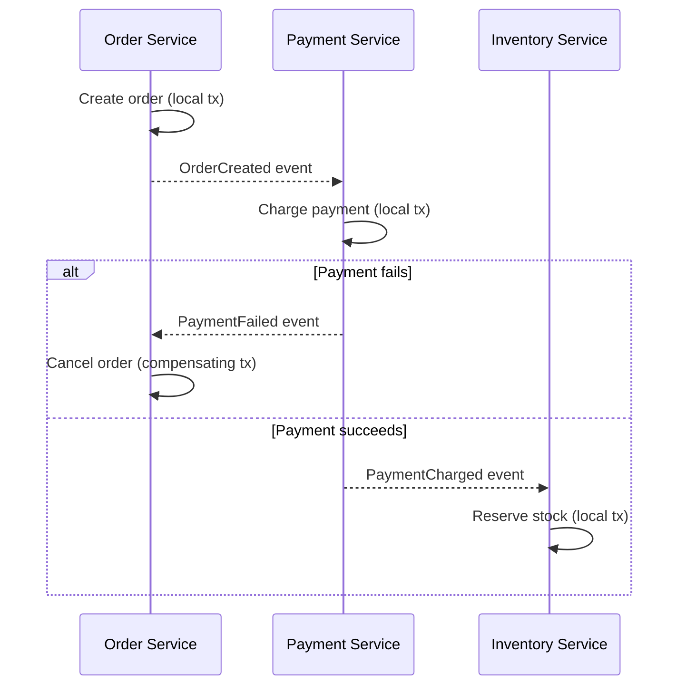

import DataManagementAndTransactionsQuestions from './_partials/04-data-management-and-transactions-questions.mdx';

# Data Management & Distributed Transactions

Splitting a system into services is easy to draw on a whiteboard; splitting its *data* is where the
real difficulty lives. A single ACID transaction across two tables in one database is
straightforward (see [Transactions & ACID](../dbms/05-transactions-and-acid.md)); the equivalent
operation across two services with two separate databases is not. This page covers why, and the
patterns used to work around it.

## Database-per-service

The default rule in microservices is **database-per-service**: each service owns its own database
(or schema), and no other service is allowed to touch it directly &mdash; every access goes through
that service's API. This is what actually makes services independently deployable: if two services
shared a database, changing one service's schema could silently break the other, re-coupling them
at the data layer even though they're deployed separately.

The cost is that any operation spanning more than one service's data can no longer use a single
local database transaction. "Place an order" might need to touch the Order service, the Payment
service, and the Inventory service's databases &mdash; and there is no single `COMMIT` that can
atomically cover all three.

## Why distributed transactions are hard: two-phase commit

The classical answer to "how do you commit a transaction across multiple databases" is **two-phase
commit (2PC)**: a coordinator asks every participant to *prepare* (lock resources, confirm it
*could* commit) in phase one, and only if every participant votes yes does the coordinator tell
everyone to actually *commit* in phase two.

2PC is rarely used across microservices in practice because:

- It's **blocking**: every participant holds its locks from *prepare* until the coordinator's
  final decision arrives, so a slow or crashed participant (or coordinator) stalls every other
  participant, holding their locks the whole time.
- It requires every participant to speak the same transaction protocol, which doesn't work well
  across the mix of databases, message brokers, and third-party APIs a real microservices system
  touches.
- It fundamentally trades away availability (see the [CAP
  theorem](../dbms/09-replication-sharding-and-nosql.md)) for consistency, which is usually the
  wrong trade for services that need to stay independently available.

## The Saga pattern

The pattern microservices actually use instead is the **Saga**: a sequence of local transactions,
one per service, where each local transaction publishes an event or message that triggers the next
step. There is no cross-service lock and no single atomic commit &mdash; instead, if a later step
fails, the Saga runs **compensating transactions** that semantically undo the effects of the steps
that already succeeded (e.g. "refund the payment" rather than a database rollback, since the
payment was already truly committed in its own service).

Sagas can be coordinated either way covered in [Service
Communication](./02-service-communication.md#orchestration-vs-choreography):

- **Orchestration-based Saga**: a central saga orchestrator explicitly calls each service in turn
  and issues compensating calls on failure. Easier to follow and monitor; the orchestrator is a
  central dependency.
- **Choreography-based Saga**: each service publishes an event when its local step completes, and
  the next service(s) react to that event, including publishing their own compensating events on
  failure. No central coordinator, but the overall flow is implicit across every participant.

The trade-off Sagas make explicit: you give up atomicity and immediate consistency in exchange for
availability and service independence. The system is only **eventually consistent** &mdash; there's
a window where the order exists but payment hasn't been confirmed yet &mdash; and application logic
has to be written with that window in mind (e.g. showing an order as "pending" rather than
"confirmed" until the Saga completes).

## The outbox pattern

A subtler problem: a single service still needs to atomically "update my own database" *and*
"publish an event telling other services what happened." If those are two separate operations (a
DB write, then a separate call to publish to Kafka), a crash between them either loses the event or
duplicates it. The **transactional outbox pattern** solves this by writing the event into an
`outbox` table in the *same local transaction* as the business data change (a single ACID commit,
local to one database), then a separate process (polling the table, or reading the database's
write-ahead log via change data capture) reliably publishes each outbox row as an event exactly
once it's durably committed. See [Kafka's Outbox & Inbox
Pattern](../kafka/06-outbox-and-inbox-pattern.md) for the full mechanics, including the
complementary **inbox pattern** consumers use to deduplicate events on the receiving side.

## Querying across services

Database-per-service also breaks the simple case of "just JOIN across two tables" once the tables
live in different services' databases. Two common answers:

- **API composition**: the caller (or an aggregating service/[API
  gateway](./03-api-gateway-and-service-discovery.md)) calls each owning service and joins the
  results in application code. Simple, but slow if it needs many calls and adds load to the
  owning services for every query.
- **CQRS with a read model**: a separate, denormalized read-optimized view is built ahead of time
  by consuming events from the owning services (often via the outbox pattern above) and kept in
  its own store, purpose-built for the exact queries the read side needs. Fast reads, but the read
  model is only ever eventually consistent with the source data, and it's an extra
  moving piece to build and operate.

:::info Interview Questions
<DataManagementAndTransactionsQuestions/>
:::
