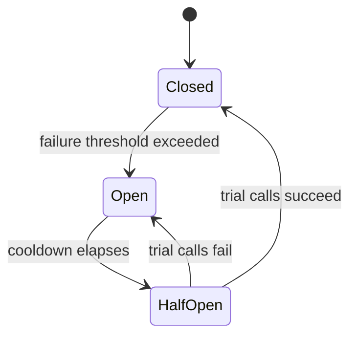

import ResiliencePatternsQuestions from './_partials/05-resilience-patterns-questions.mdx';

# Resilience Patterns

In a monolith, a failing function call is a local exception. In microservices, a failing call is a
failing *network* call to a process you don't control, running on hardware you don't control, and
it can fail slowly (a hang) just as easily as it can fail fast (a connection refused). Resilience
patterns exist to stop one struggling service from taking down every service that calls it.

## Cascading failure

The core danger this whole page is about: Service A calls Service B, which is slow or down. If A
does nothing special, its requests to B pile up waiting on responses (or timeouts), consuming A's
own threads/connections until A itself becomes unresponsive to *its* callers &mdash; even though A
itself was perfectly healthy. This is a **cascading failure**, and it's how a single slow
dependency deep in a call graph can take down an entire system. Every pattern below is a way of
containing a failure to the service that actually failed.

## Timeout

The most basic protection: never wait indefinitely for a dependency. A **timeout** bounds how long
a caller will wait before giving up and treating the call as failed. Without timeouts, a hung
downstream call ties up the caller's resources indefinitely, which is often worse than an outright
error &mdash; a fast, clear failure is easier to handle than a slow one.

## Retry (with backoff)

**Retry** re-attempts a failed call, on the assumption that many failures are transient (a brief
network blip, momentary overload). Naive immediate retries make things worse under real load
&mdash; if a downstream service is struggling because it's overloaded, an instant retry from every
caller adds more load right when it's least able to handle it (a **retry storm**). The fix:
**exponential backoff** (wait progressively longer between attempts) plus **jitter** (randomize the
wait slightly so many callers don't retry in lockstep). Retries should also only be applied to
operations that are safe to repeat (**idempotent** operations, or a clearly retriable class of
error) &mdash; retrying a non-idempotent "charge this payment" call blindly can double-charge a
customer.

## Circuit breaker

A **circuit breaker** wraps calls to a dependency and tracks their failure rate. It has three
states:

- **Closed**: calls go through normally; failures are counted.
- **Open**: once failures cross a threshold, the breaker "trips" &mdash; further calls fail
  immediately without even attempting the network call, for a configured cooldown period. This is
  what actually stops cascading failure: the caller stops hammering (and waiting on) a dependency
  that's already struggling.
- **Half-open**: after the cooldown, a limited number of trial calls are let through. If they
  succeed, the breaker closes again; if they fail, it reopens.

Circuit breaking and retry are complementary, not competing: retry handles brief, isolated blips;
the circuit breaker handles a dependency that's sustained-failing and stops the caller from wasting
resources (and adding load) on a lost cause until it has a chance to recover. In the Spring Boot
ecosystem this is typically implemented with **Resilience4j** (the successor to the now-archived
Netflix Hystrix), often wired in via an AOP-style annotation (see [AOP &
Proxies](../spring-boot/06-aop-and-proxies.md) for how that interception actually works).

## Bulkhead

A **bulkhead** isolates resources (thread pools, connection pools) *per dependency*, so that one
overwhelmed dependency can only exhaust the resources allocated to calls against it, not the
resources shared by calls to every other dependency. The name comes from ship design: bulkheads are
the compartment walls that keep one flooded section from sinking the whole ship. Without bulkheads,
a single slow dependency can starve a shared thread pool and take down calls to completely unrelated
&mdash; and otherwise healthy &mdash; dependencies.

## Rate limiting

**Rate limiting** caps how many requests a caller can make in a given time window, protecting a
service from being overwhelmed &mdash; whether by a genuine traffic spike, a buggy retry loop in a
caller, or abuse. It's usually enforced at the [API gateway](./03-api-gateway-and-service-discovery.md)
for external traffic, and sometimes between internal services too. Common algorithms: token bucket
(allows controlled bursts) and sliding window (smooths the limit over time); both trade off burst
tolerance against strict fairness.

## Putting it together

These patterns compose: a typical resilient call to a downstream service has a **timeout** bounding
each attempt, a **retry with backoff** for transient failures within that timeout budget, wrapped in
a **circuit breaker** so sustained failure stops retries from piling on load, drawing from a
**bulkhead**-isolated resource pool so it can't starve calls to unrelated dependencies. None of
these patterns eliminate failure &mdash; distributed systems fail; the goal is to fail fast,
contained, and recoverably instead of slowly and system-wide.

:::info Interview Questions
<ResiliencePatternsQuestions/>
:::
