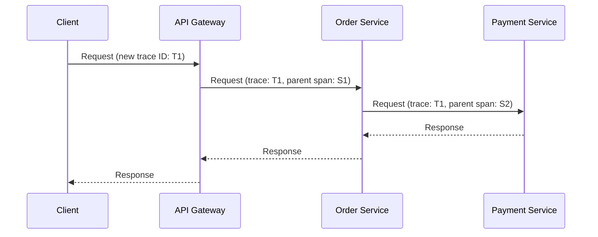

import ObservabilityQuestions from './_partials/06-observability-questions.mdx';

# Observability

In a monolith, a stack trace tells you almost everything about a failure. In microservices, the
request that failed may have passed through five services, and no single log file or stack trace
shows the whole path. Observability is how you reconstruct "what actually happened" across a
distributed system, and it rests on three complementary pillars: logs, metrics, and traces.

## Logs, metrics, and traces

- **Logs** are discrete, timestamped events emitted by a single service &mdash; the most detailed
  signal, but scattered across every instance of every service unless aggregated centrally.
- **Metrics** are numeric measurements aggregated over time (request rate, error rate, latency
  percentiles, CPU/memory) &mdash; cheap to store and great for dashboards and alerting, but they
  tell you *that* something is wrong, not *why*.
- **Traces** follow a single request as it moves across every service it touches, showing exactly
  where time was spent and where it failed.

None of the three replaces the others: metrics tell you *something* is wrong and roughly *where*
(which service, since when), traces narrow it down to *which specific request path and hop*, and
logs from that specific hop give you the detailed *why*.

## Distributed tracing

A **distributed trace** represents one end-to-end request as a tree of **spans** &mdash; a span is
a single unit of work (e.g. "Order service handling this request," or "the call this service made
to Payment service"), with a start time, duration, and its own metadata/tags. Every span carries the
same **trace ID**, and each span (except the first) carries the ID of its **parent span**, which is
what lets tracing tools reconstruct the full call tree afterward.

The mechanical trick that makes this possible across process boundaries: **context propagation**.
When Service A calls Service B, A includes the trace ID (and its own span ID, as the parent) in the
outgoing request's headers; B reads those headers, starts its own span as a child of A's, and
propagates the same trace ID onward to anything *it* calls. If any service in the chain drops those
headers, the trace breaks into disconnected fragments. Tools like Jaeger, Zipkin, and the
OpenTelemetry standard implement this propagation and the collection/visualization of the resulting
traces.

## Correlation IDs

Even before full distributed tracing, a simpler and widely-used technique is a **correlation ID**
(sometimes just "request ID"): a single identifier generated at the edge (or by the first service
to see a request) and passed through every downstream call and included in every log line each
service emits for that request. It doesn't give you span-level timing the way a trace does, but it
lets you grep centralized logs across every service for one ID and reconstruct the request's path
&mdash; often the fastest way to debug an incident when full tracing infrastructure isn't in place
or a specific service isn't instrumented for it yet.

## Centralized logging

Because each service instance has its own local logs, and instances are constantly created and
destroyed (see [Deployment & Orchestration](./07-deployment-and-orchestration.md)), logs need to be
shipped off the instance and aggregated centrally (e.g. the ELK/EFK stack &mdash;
Elasticsearch/OpenSearch + Logstash/Fluentd + Kibana &mdash; or a managed equivalent) to be useful
at all; by the time someone wants to debug an issue, the specific pod that logged it may no longer
exist. Structured logging (emitting logs as JSON with consistent fields, including the correlation
ID or trace ID above) is what makes that aggregated log data actually searchable rather than just a
wall of text.

## Health checks: readiness vs. liveness

Two related but distinct checks, most concretely defined by Kubernetes but applicable to any
orchestrated deployment:

- **Liveness**: "is this instance still running correctly, or should it be killed and restarted?"
  A failing liveness check triggers a restart &mdash; it's meant to catch a process that's stuck or
  deadlocked and can't recover on its own.
- **Readiness**: "is this instance currently able to serve traffic?" A failing readiness check
  doesn't restart the instance &mdash; it just temporarily removes it from load-balancing/service
  discovery until it passes again (e.g. while it's still warming up a cache, or briefly can't reach
  a downstream dependency it needs).

Conflating the two is a common mistake: treating every readiness failure as a reason to restart can
cause restart loops for a transient, self-recovering condition (like a downstream dependency being
briefly unavailable) instead of just pulling the instance out of rotation until it recovers.

:::info Interview Questions
<ObservabilityQuestions/>
:::
