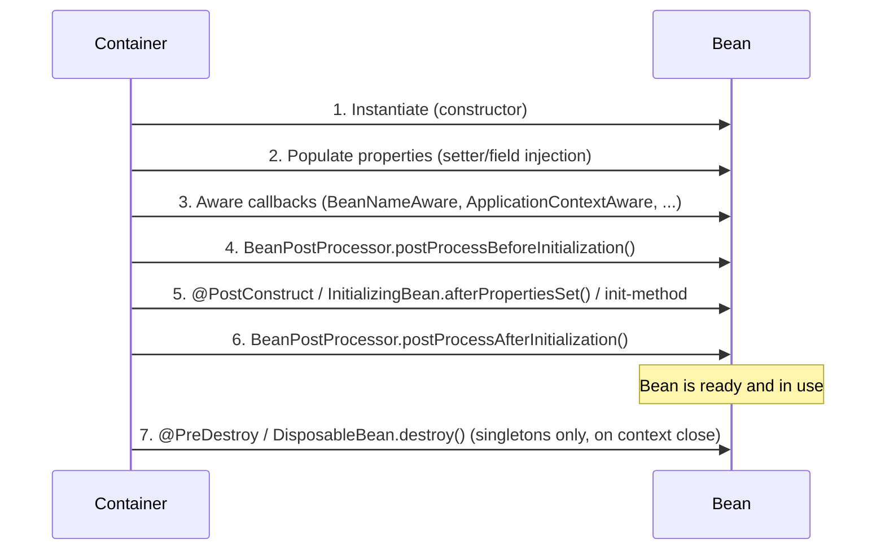

import IocAndDependencyInjectionQuestions from './_partials/02-ioc-and-dependency-injection-questions.mdx';

# IoC & Dependency Injection

Every Spring Boot interview starts here, and most candidates can define "inversion of control" but
can't explain what actually happens between `new AnnotationConfigApplicationContext()` and a
controller being ready to serve traffic. This page builds the mechanical model: how beans are
found, wired, initialized, and torn down.

## Inversion of control

In plain Java, an object creates or looks up its own collaborators (`new PaymentGateway()`). With
**inversion of control**, that responsibility is inverted: an external container constructs
objects and hands them their dependencies. The object itself never calls `new` on a collaborator
it needs — it just declares what it needs and receives it. **Dependency injection** is the
specific technique Spring uses to achieve IoC: the container injects dependencies via constructor,
setter, or field.

The container is the `ApplicationContext`. `BeanFactory` is its more primitive ancestor interface —
lazy, minimal, rarely used directly today. `ApplicationContext` extends `BeanFactory` and adds
eager singleton instantiation by default, event publishing, internationalization, and integration
with `BeanPostProcessor`/`BeanFactoryPostProcessor` out of the box, which is why it's what every
Spring Boot application actually runs on.

## Declaring beans

Two mechanisms, both ending up in the same container:

```java
@Service // stereotype annotation, component-scanned automatically
public class PaymentService {
    private final PaymentGateway gateway;

    public PaymentService(PaymentGateway gateway) { // constructor injection
        this.gateway = gateway;
    }
}
```

```java
@Configuration
public class PaymentConfig {
    @Bean
    public PaymentGateway paymentGateway(GatewayProperties props) {
        return new StripeGateway(props.getApiKey()); // full control over construction
    }
}
```

Use stereotypes (`@Component`, `@Service`, `@Repository`, `@Controller`) for classes you own and
want component-scanned. Use `@Bean` methods in a `@Configuration` class when you need to construct
a third-party class you don't own, need conditional/programmatic construction logic, or need to
produce multiple beans of the same type with different configuration.

`@Repository` and `@Service` are semantically identical to `@Component` for wiring purposes —
`@Repository` additionally enables Spring's persistence-exception translation (wrapping
JDBC/JPA-specific exceptions into Spring's `DataAccessException` hierarchy).

## Constructor vs. field vs. setter injection

```java
// Field injection - avoid
@Autowired
private PaymentGateway gateway;

// Setter injection - rare, mainly for optional dependencies
@Autowired(required = false)
public void setGateway(PaymentGateway gateway) { this.gateway = gateway; }

// Constructor injection - preferred
private final PaymentGateway gateway;
public PaymentService(PaymentGateway gateway) { this.gateway = gateway; }
```

Constructor injection is preferred because:
- It lets `gateway` be `final` — the object is never in a half-constructed, dependency-less state.
- It makes required dependencies explicit in the type signature, so missing wiring fails at
  **application startup**, not with a `NullPointerException` at request time.
- It's trivially testable with plain `new PaymentService(mockGateway)` — no reflection or Spring
  context needed in unit tests.
- A constructor with too many parameters is an immediate, visible signal that the class is doing
  too much — field injection hides that smell.

With a single constructor, `@Autowired` on it is optional since Spring 4.3 — it's implied.

## Bean scopes

| Scope | Lifecycle | Typical use |
|---|---|---|
| `singleton` (default) | One instance per container | Stateless services, repositories |
| `prototype` | New instance every time the bean is requested | Stateful, non-thread-safe helper objects |
| `request` | One instance per HTTP request (web-aware contexts) | Per-request state, e.g. a request-scoped audit context |
| `session` | One instance per HTTP session | Per-user shopping cart, wizard state |
| `application` | One instance per `ServletContext` | Rarely used; similar to singleton but scoped to the servlet context |

The interview trap: **injecting a `prototype` bean into a `singleton` bean** only resolves it
*once*, at the singleton's construction time — you get the same prototype instance forever, not a
fresh one per use, because the singleton is only wired once. To get a fresh prototype instance on
every call, inject an `ObjectProvider<T>` (or `Provider<T>`) and call `.getObject()` each time, or
use scoped proxies (`proxyMode = ScopedProxyMode.TARGET_CLASS`).

## Bean lifecycle



`BeanPostProcessor` is the extension point that powers a lot of "magic" in the framework: AOP
proxy creation, `@Transactional`/`@Async` wrapping, and `@Autowired`/`@Value` field injection are
all implemented as `BeanPostProcessor`s running around step 4-6. `@PostConstruct` is the idiomatic
choice today over implementing `InitializingBean` — it doesn't couple the class to a Spring
interface.

Prototype-scoped beans only go through steps 1-6; the container hands them off and never tracks
them for destruction, so `@PreDestroy` is never called on a prototype bean by the container.

## Circular dependencies

```java
@Service
public class OrderService {
    public OrderService(InventoryService inventoryService) { ... }
}

@Service
public class InventoryService {
    public InventoryService(OrderService orderService) { ... } // circular!
}
```

With **field/setter injection**, Spring can resolve this: it uses a three-level cache of
early-exposed, not-yet-fully-initialized bean references, instantiating `OrderService`, exposing an
early reference of it before its properties are set, using that early reference to fully construct
`InventoryService`, then finishing `OrderService`'s property population with the now-complete
`InventoryService`.

With **constructor injection**, this is unresolvable and fails fast at startup with a
`BeanCurrentlyInCreationException` — a constructor needs the *fully constructed* dependency, and
there's no "early reference" a constructor argument can hold. This is considered a **feature, not
a limitation**: a circular constructor dependency is almost always a real design problem (the two
services should be merged, or the shared behavior extracted into a third bean), and Spring making
it a startup failure instead of quietly working around it via field injection surfaces the design
issue immediately. The escape hatch, when truly needed, is `@Lazy` on one constructor parameter, so
that side gets a lazy-initializing proxy instead of the real bean.

## `@Qualifier` vs. `@Primary`

When two beans implement the same interface, `@Autowired` by type is ambiguous:

```java
public interface NotificationSender {}

@Component @Primary
public class EmailNotificationSender implements NotificationSender {}

@Component
public class SmsNotificationSender implements NotificationSender {}

@Service
public class AlertService {
    public AlertService(@Qualifier("smsNotificationSender") NotificationSender sender) {}
}
```

`@Primary` declares a default candidate used whenever a specific one isn't requested. `@Qualifier`
overrides that default at the injection point by name. If neither is present and multiple
candidates exist, context startup fails with a `NoUniqueBeanDefinitionException`.

:::info Interview Questions
<IocAndDependencyInjectionQuestions/>
:::
