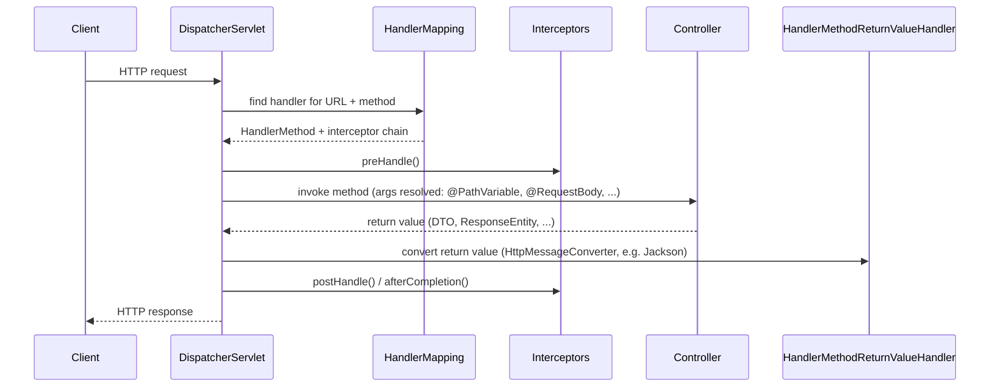

import SpringMvcAndRestQuestions from './_partials/04-spring-mvc-and-rest-questions.mdx';

# Spring MVC & REST

Building a `@RestController` is the easy part; interviewers use this topic to check whether you
understand what happens *around* your method — request routing, argument resolution, validation,
and error handling — because that's where production REST APIs actually break.

## The request pipeline



Every request to a Spring MVC application passes through a single front controller,
`DispatcherServlet`. It doesn't handle requests itself — it delegates: a `HandlerMapping` finds
which controller method matches the URL/HTTP method, argument resolvers populate the method's
parameters (`@PathVariable`, `@RequestParam`, `@RequestBody` via an `HttpMessageConverter` like
Jackson), the method runs, and the return value is converted back to the HTTP response by the same
message-converter mechanism in reverse. `@RestController` is `@Controller` + `@ResponseBody`
combined — every method's return value is written directly to the response body instead of being
resolved as a view name.

## Binding request data

```java
@RestController
@RequestMapping("/api/orders")
@RequiredArgsConstructor
public class OrderController {

    private final OrderService orderService;

    @GetMapping("/{id}")
    public OrderResponse getOrder(@PathVariable Long id) {
        return orderService.findById(id);
    }

    @GetMapping
    public List<OrderResponse> search(@RequestParam(required = false) String status,
                                       @RequestParam(defaultValue = "0") int page) {
        return orderService.search(status, page);
    }

    @PostMapping
    @ResponseStatus(HttpStatus.CREATED)
    public OrderResponse create(@Valid @RequestBody CreateOrderRequest request) {
        return orderService.create(request);
    }
}
```

- `@PathVariable` binds a URI template segment; `@RequestParam` binds a query parameter.
- `@RequestBody` deserializes the request body via the negotiated `HttpMessageConverter`
  (Jackson's `MappingJackson2HttpMessageConverter` for JSON, by default).
- `@Valid` (or `@Validated`) triggers Bean Validation on the deserialized object *before* the
  controller method body runs.

## Validation

```java
public record CreateOrderRequest(
    @NotBlank String customerId,
    @NotEmpty List<@Valid OrderLineRequest> lines,
    @Positive BigDecimal totalAmount
) {}
```

`@Valid` on a `@RequestBody` parameter causes Spring to run Bean Validation (Hibernate Validator)
against the deserialized object. A failure throws `MethodArgumentNotValidException` — it never
reaches the controller body — which by default produces a `400 Bad Request` with a structured
error body listing every failed constraint.

## Centralized exception handling

```java
@RestControllerAdvice
public class ApiExceptionHandler {

    @ExceptionHandler(MethodArgumentNotValidException.class)
    public ResponseEntity<ErrorResponse> handleValidation(MethodArgumentNotValidException ex) {
        var errors = ex.getBindingResult().getFieldErrors().stream()
            .map(e -> new FieldError(e.getField(), e.getDefaultMessage()))
            .toList();
        return ResponseEntity.badRequest().body(new ErrorResponse("VALIDATION_FAILED", errors));
    }

    @ExceptionHandler(OrderNotFoundException.class)
    public ResponseEntity<ErrorResponse> handleNotFound(OrderNotFoundException ex) {
        return ResponseEntity.status(HttpStatus.NOT_FOUND)
            .body(new ErrorResponse("ORDER_NOT_FOUND", ex.getMessage()));
    }
}
```

`@RestControllerAdvice` (`@ControllerAdvice` + `@ResponseBody`) applies globally across every
controller in the application by default — no per-controller try/catch needed. `@ExceptionHandler`
methods are matched by the *most specific* exception type in the hierarchy, so a handler for
`OrderNotFoundException` wins over a broader `Exception` handler for the same thrown exception,
regardless of declaration order in the class. Without any matching `@ExceptionHandler`, an
uncaught exception falls through to Spring Boot's default `BasicErrorController`, which produces a
generic `500` (or a mapped status, if the exception is annotated `@ResponseStatus`).

## Content negotiation

Spring MVC picks a response representation based on the `Accept` header (JSON by default when
Jackson is on the classpath, since `spring-boot-starter-web` registers
`MappingJackson2HttpMessageConverter` automatically). If a client requests a media type with no
registered `HttpMessageConverter` able to produce it, Spring returns `406 Not Acceptable`. Adding
XML support, for example, is as simple as putting `jackson-dataformat-xml` on the classpath — no
controller code changes required, because negotiation and conversion are handled entirely by the
message-converter layer, not by the controller method.

:::info Interview Questions
<SpringMvcAndRestQuestions/>
:::
