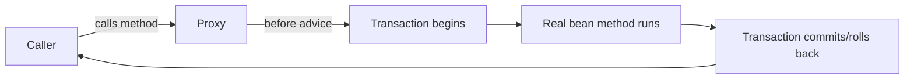

import AopAndProxiesQuestions from './_partials/06-aop-and-proxies-questions.mdx';

# AOP & Proxies

`@Transactional`, `@Async`, `@Cacheable`, and `@Retryable` all *feel* like language features, but
none of them are — they're all implemented through the same proxy mechanism described here. Once
you understand how a Spring AOP proxy works, the "self-invocation" gotcha that trips up
`@Transactional` (see [Spring Data JPA & Transactions](./05-spring-data-jpa-and-transactions.md))
stops being a mysterious edge case and becomes an obvious consequence of the mechanism.

## What AOP solves

Cross-cutting concerns — logging, transaction management, security checks, caching, retries — apply
to many otherwise-unrelated methods across the codebase. Writing them inline in every method
duplicates the same boilerplate everywhere and tangles business logic with infrastructure concerns.
**Aspect-Oriented Programming** lets you define that behavior once, as an **aspect**, and declare
*where* it applies via a **pointcut** expression, without touching the target method's code.

```java
@Aspect
@Component
public class LoggingAspect {

    @Around("@annotation(com.acme.Loggable)")
    public Object logExecutionTime(ProceedingJoinPoint pjp) throws Throwable {
        long start = System.currentTimeMillis();
        Object result = pjp.proceed(); // invokes the real method
        log.info("{} took {}ms", pjp.getSignature(), System.currentTimeMillis() - start);
        return result;
    }
}
```

## Advice types

| Advice | Runs |
|---|---|
| `@Before` | Before the target method |
| `@After` | After the target method, regardless of outcome (finally-like) |
| `@AfterReturning` | After the target method returns normally |
| `@AfterThrowing` | After the target method throws |
| `@Around` | Wraps the call entirely — must explicitly call `pjp.proceed()`, giving full control over whether/how/how-many-times the target runs |

`@Around` is the most powerful (and what `@Transactional`/`@Cacheable`/`@Retryable` are built on
internally) because it can skip calling `proceed()` altogether (e.g. return a cached value without
running the method), call it multiple times (retry), or modify arguments/return value.

## How Spring implements this: proxies, not bytecode weaving

Unlike full AspectJ (which weaves advice directly into compiled bytecode at compile- or
load-time), **Spring AOP works purely through runtime proxies** wrapping the target bean. When the
container detects a bean needs advice applied (a `@Transactional` method, a bean matched by an
`@Aspect` pointcut, etc.), it doesn't hand callers the real object — it hands them a proxy:

- **JDK dynamic proxy** — used when the target class implements at least one interface; the proxy
  implements the same interface(s) and delegates to the real object through
  `InvocationHandler.invoke()`.
- **CGLIB proxy** — used when the target class implements no interface (or when
  `proxyTargetClass = true` is forced); CGLIB generates a runtime subclass of the target class that
  overrides its methods to add the advice, then delegates to `super`.



This is exactly why the **self-invocation problem** exists: the proxy sits *around* the bean, not
*inside* it. Any call that originates from inside the bean itself (`this.someMethod()`) goes
directly to the real object, never touching the proxy, so none of the advice — transactional
boundaries, caching, retries, security checks — runs.

## CGLIB implications

Because CGLIB proxies work by subclassing, two consequences show up in interviews:

- **`final` classes and methods can't be proxied by CGLIB** — there's nothing to subclass/override.
  A `final` class with `@Transactional` methods silently gets no transaction behavior (or, in
  modern Spring Boot, fails fast with a clear error depending on configuration).
- **The target class needs a no-arg constructor** in older CGLIB versions (relaxed in modern
  versions using objenesis to instantiate without calling a constructor at all).

Since Spring Boot 2.0, CGLIB proxying (`proxyTargetClass=true`) is the default even for classes
that do implement an interface, for consistency — you get the same proxy type whether or not a
bean happens to implement an interface.

:::info Interview Questions
<AopAndProxiesQuestions/>
:::
