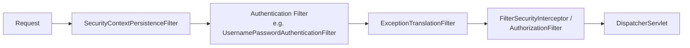

import SpringSecurityQuestions from './_partials/07-spring-security-questions.mdx';

# Spring Security

Spring Security interviews rarely ask you to recite annotation names — they ask you to trace a
request through the filter chain and explain *where* a given check happens, because that's what
tells them you could actually debug a "why is this endpoint returning 403" incident.

## The filter chain



Every request to a secured application passes through a chain of servlet `Filter`s **before**
reaching `DispatcherServlet` — Spring Security sits entirely in front of Spring MVC, at the servlet
filter layer, not inside it. Key filters: one establishes/restores the `SecurityContext`
(who, if anyone, is currently authenticated), one performs authentication for login-style requests,
`ExceptionTranslationFilter` catches `AuthenticationException`/`AccessDeniedException` and converts
them into the right HTTP response (401 vs. 403 — see below), and the final authorization filter
decides, per matched request, whether the authenticated principal is allowed through.

## Authentication vs. authorization

- **Authentication**: *who are you?* — verifying credentials (username/password, a JWT signature,
  an OAuth2 token) and producing a `SecurityContext` holding an `Authentication` object
  (principal + granted authorities).
- **Authorization**: *what are you allowed to do?* — given an already-authenticated principal,
  checking whether it has the required authority/role for the requested resource.

This distinction is exactly why a request with no/invalid credentials gets **401 Unauthorized**
(authentication failed or is missing) while a request from a *valid, authenticated* user lacking
the right role gets **403 Forbidden** (authorization failed) — a very common interview
clarification question.

## Configuring the filter chain

```java
@Configuration
@EnableWebSecurity
public class SecurityConfig {

    @Bean
    public SecurityFilterChain filterChain(HttpSecurity http) throws Exception {
        http
            .csrf(csrf -> csrf.disable()) // stateless API - see CSRF section below
            .sessionManagement(sm -> sm.sessionCreationPolicy(SessionCreationPolicy.STATELESS))
            .authorizeHttpRequests(auth -> auth
                .requestMatchers("/api/public/**").permitAll()
                .requestMatchers("/api/admin/**").hasRole("ADMIN")
                .anyRequest().authenticated())
            .addFilterBefore(jwtAuthFilter(), UsernamePasswordAuthenticationFilter.class)
            .oauth2ResourceServer(oauth2 -> oauth2.jwt(Customizer.withDefaults()));
        return http.build();
    }
}
```

Since Spring Security 5.7, configuration is done via a `SecurityFilterChain` bean (the
lambda-DSL style above) rather than extending `WebSecurityConfigurerAdapter`, which is deprecated —
this lets you compose multiple independent `SecurityFilterChain` beans (e.g. one for `/api/**`
with JWT, one for `/admin/**` with form login) matched by request pattern.

## CSRF

Cross-Site Request Forgery protection matters when a **browser session cookie** is the credential —
a malicious site can make the victim's browser send a request with their valid session cookie
attached, and CSRF tokens stop that by requiring a token the attacker's page can't read. It's
enabled by default in Spring Security. For **stateless, token-based APIs** (JWT/OAuth2 bearer
tokens sent explicitly in an `Authorization` header, no cookie involved), CSRF protection is
typically disabled — there's no ambient credential a forged cross-site request could ride on, since
the attacker's page has no way to read and attach the caller's bearer token.

## JWT-based stateless authentication

```java
public class JwtAuthenticationFilter extends OncePerRequestFilter {
    @Override
    protected void doFilterInternal(HttpServletRequest req, HttpServletResponse res, FilterChain chain)
            throws ServletException, IOException {
        String token = extractBearerToken(req);
        if (token != null && jwtService.isValid(token)) {
            Authentication auth = jwtService.toAuthentication(token);
            SecurityContextHolder.getContext().setAuthentication(auth);
        }
        chain.doFilter(req, res);
    }
}
```

With `SessionCreationPolicy.STATELESS`, Spring Security never creates or reads an
`HttpSession` — every request must carry and prove its own identity (the JWT), and a custom filter
placed before the standard authentication filter validates the token's signature/expiry and
populates the `SecurityContext` for that request only. This trades the convenience of
server-managed sessions for horizontal scalability: any instance behind a load balancer can
validate a self-contained JWT without shared session state.

## Method security

```java
@PreAuthorize("hasRole('ADMIN') or #order.customerId == authentication.name")
public Order cancelOrder(Order order) { ... }
```

`@EnableMethodSecurity` (successor to `@EnableGlobalMethodSecurity`) lets you enforce authorization
at the **service method** level via `@PreAuthorize`/`@PostAuthorize`, evaluated with Spring
Expression Language and access to method arguments — useful when the authorization rule depends on
domain data (e.g. "only the order's own customer or an admin"), not just the URL pattern that
`authorizeHttpRequests` can express.

:::info Interview Questions
<SpringSecurityQuestions/>
:::
